# BrighterScript Game Engine

[](https://github.com/markwpearce/brighterscript-game-engine/actions/workflows/validate.yml)
[](https://github.com/markwpearce/brighterscript-game-engine/actions/workflows/unit-tests.yml)
[](https://markwpearce.github.io/brighterscript-game-engine)
[](LICENSE)

Real 2D and 3D games on a Roku: chase cameras, voxel terrain, textured 3D models, tile maps, fighting games and visual novels, all written in object-oriented [BrighterScript](https://github.com/rokucommunity/brighterscript). Use the whole engine, or just its renderer inside your own app.

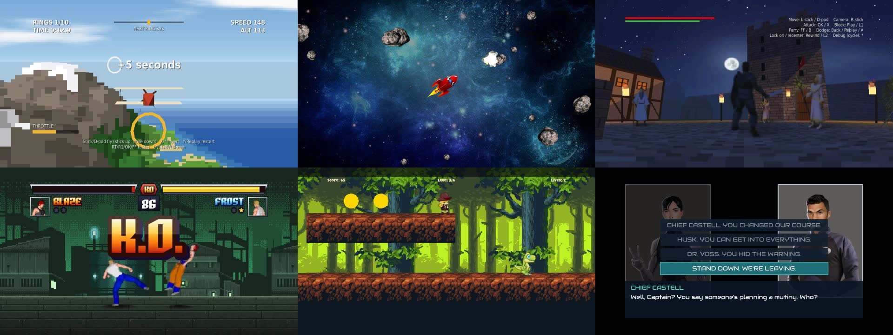

<sub>Top: [flightSim](https://github.com/markwpearce/brighterscript-game-engine/tree/main/examples/flightSim), [asteroids](https://github.com/markwpearce/brighterscript-game-engine/tree/main/examples/asteroids), [thirdPerson](https://github.com/markwpearce/brighterscript-game-engine/tree/main/examples/thirdPerson). Bottom: [fighter](https://github.com/markwpearce/brighterscript-game-engine/tree/main/examples/fighter), [platformer](https://github.com/markwpearce/brighterscript-game-engine/tree/main/examples/platformer), [visualnovel](https://github.com/markwpearce/brighterscript-game-engine/tree/main/examples/visualnovel). Every one of these is a capture from a real Roku.</sub>

## See it move

<p>
  <a href="https://github.com/markwpearce/brighterscript-game-engine/tree/main/examples/flightSim"></a>
  <a href="https://github.com/markwpearce/brighterscript-game-engine/tree/main/examples/thirdPerson">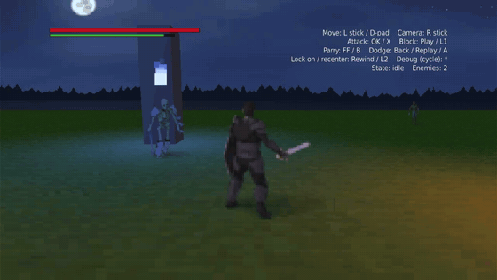</a>
  <a href="https://github.com/markwpearce/brighterscript-game-engine/tree/main/examples/platformer">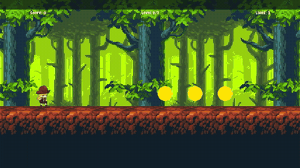</a>
</p>

## Features

**3D**
- A real 3D renderer built on `Draw2D`: textured `.obj` and `.stl` models, billboards, sprites that face the camera, ground planes, walls and a skybox. [Drawables guide](https://markwpearce.github.io/brighterscript-game-engine/drawables-and-scene-objects)
- Cameras for third-person games: `OrbitCamera`, `ChaseCamera` and `FollowCamera`, with a camera boom that won't clip through walls, and lock-on. [Third-person cameras](https://markwpearce.github.io/brighterscript-game-engine/third-person-cameras)
- Voxel terrain you can fly over, from a `.bvox` heightmap or a generated one. [Voxel terrain](https://markwpearce.github.io/brighterscript-game-engine/voxel-terrain)
- Built to stay smooth on low-end Rokus like the Express: model impostors, fog, occlusion, and render-quality levels that adjust as the frame rate changes. [Render quality](https://markwpearce.github.io/brighterscript-game-engine/render-quality)
- 3D colliders and raycasts, plus particles with line, rectangle, image and animated shapes. [3D colliders](https://markwpearce.github.io/brighterscript-game-engine/colliders-3d)

**2D and worlds**
- Sprites, animations, shapes, text, parallax layers and tweens.
- [Tiled](https://www.mapeditor.org/) and character-grid tile maps, with tile collision and sliding along walls. [Tile maps](https://markwpearce.github.io/brighterscript-game-engine/tile-maps)
- A\* pathfinding on a grid that re-plans when doors open or close. [Pathfinding](https://markwpearce.github.io/brighterscript-game-engine/pathfinding)
- Depth sorting, so the player walks in front of and behind props.

**Game systems**
- `GameEntity` and `GameScene` with `onCreate`, `onUpdate`, `onCollision` and `onDrawBegin`/`onDrawEnd` hooks, much like Phaser, HaxeFlixel or GameMaker. [Overview](https://markwpearce.github.io/brighterscript-game-engine/game-engine-overview)
- Branching stories and visual novels: flags, an inventory, a backlog and a dialogue view. [Story](https://markwpearce.github.io/brighterscript-game-engine/story)
- A retained-mode UI: menus, pause menus, sliders, text input and an on-screen keyboard, with HUD widgets for meters, banners and credits. [UI menus](https://markwpearce.github.io/brighterscript-game-engine/ui-menus) · [HUD widgets](https://markwpearce.github.io/brighterscript-game-engine/hud-widgets)
- Score, lives and game-over flow, plus health, stamina and respawn helpers. [Game session](https://markwpearce.github.io/brighterscript-game-engine/game-session)
- Save slots and profiles in the Roku registry. [Saving](https://markwpearce.github.io/brighterscript-game-engine/saving)
- Asset loading in the background, with loading screens, and an engine splash screen. [Loading assets](https://markwpearce.github.io/brighterscript-game-engine/loading-assets) · [Splash screen](https://markwpearce.github.io/brighterscript-game-engine/splash-screen)

**Roku integration**
- Use a phone as a gamepad: scan a QR code on the TV, and every player gets their own controller. A gamepad connected to the phone or computer showing that page works too. [Controller input](https://markwpearce.github.io/brighterscript-game-engine/controller-input) · [QR codes](https://markwpearce.github.io/brighterscript-game-engine/qr-codes)
- Draw the engine on top of a SceneGraph app, or use its SceneGraph shape components without the game loop. [SceneGraph shapes](https://markwpearce.github.io/brighterscript-game-engine/scenegraph-shapes)
- Deep links into any scene for testing. [Launch params](https://markwpearce.github.io/brighterscript-game-engine/launch-params)

**Dev workflow**
- Debug overlays for FPS, colliders, memory and garbage collection.
- Use only what you need: the `Renderer`/`Canvas` layer works on its own as a drawing library for an existing Roku app.
- Develop without a Roku: the engine runs under the [BrightScript Simulator](https://github.com/lvcabral/brs-desktop), Marcelo Lv Cabral's desktop simulator.

## A quick taste

```brightscript
sub main()
  game = new BGE.Game(1280, 720)
  game.fitCanvasToScreen()
  game.loadBitmap("player", "pkg:/sprites/player.png")

  scene = new MainScene(game)
  game.defineScene(scene)
  game.changeScene(scene.name)

  game.play()
end sub
```

```brightscript
class MainScene extends BGE.GameScene

  sub new(game as BGE.Game)
    super(game)
    m.name = "MainScene"
  end sub

  override sub onCreate(args as roAssociativeArray)
    m.game.addEntity(new Player(m.game))
  end sub

end class
```

```brightscript
class Player extends BGE.GameEntity

  sub new(game as BGE.Game)
    super(game)
    m.name = "Player"
  end sub

  override sub onCreate(args as roAssociativeArray)
    m.position = m.game.canvas.renderer.getCanvasCenter()
    bitmap = m.game.getBitmap("player")
    region = CreateObject("roRegion", bitmap, 0, 0, bitmap.GetWidth(), bitmap.GetHeight())
    m.addImage("sprite", region)
    m.addCircleCollider("body", bitmap.GetWidth() / 2)
  end sub

  override sub onInput(input as BGE.GameInput)
    m.velocity.x = input.x * 600
    m.velocity.y = input.y * 600
  end sub

  override sub onCollision(myCollider as BGE.Collider, otherCollider as BGE.Collider, otherEntity as BGE.GameEntity)
    m.game.postGameEvent("player_hit", {by: otherEntity})
  end sub

end class
```

This exact code, plus a Back button to quit, lives in [`examples/quickstart`](https://github.com/markwpearce/brighterscript-game-engine/tree/main/examples/quickstart) as a runnable app. See the [Documentation](https://markwpearce.github.io/brighterscript-game-engine) for the full API, and the examples below for complete, runnable projects.

## Examples

The `examples/` directory has full Roku channels you can build and run.

**Games**

| Example | What it shows | |
| --- | --- | --- |
| [`flightSim`](https://github.com/markwpearce/brighterscript-game-engine/tree/main/examples/flightSim) | Fly a biplane round a voxel island through a course of rings, with a chase camera | 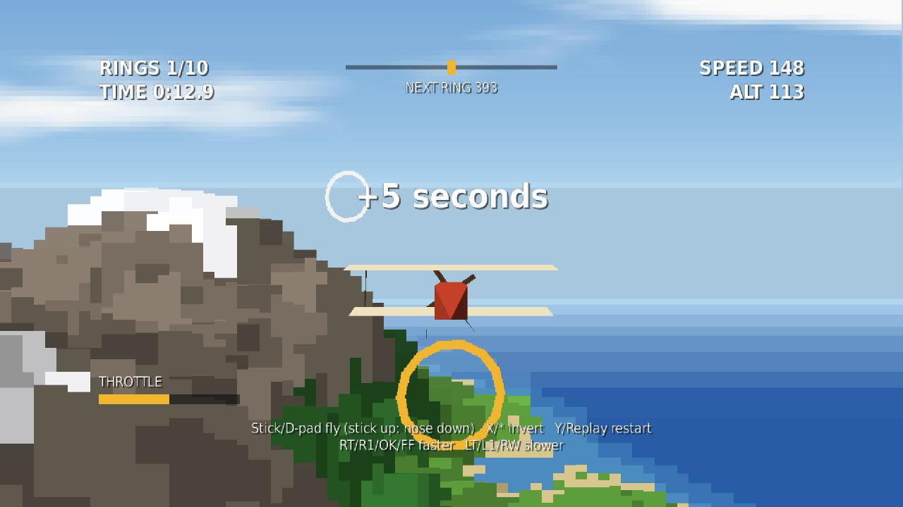 |
| [`thirdPerson`](https://github.com/markwpearce/brighterscript-game-engine/tree/main/examples/thirdPerson) | A souls-like action game in 3D (work in progress, issue #385): a walled town, a graveyard and a three-level crypt with bosses, lock-on combat, stamina, fog and torchlight | 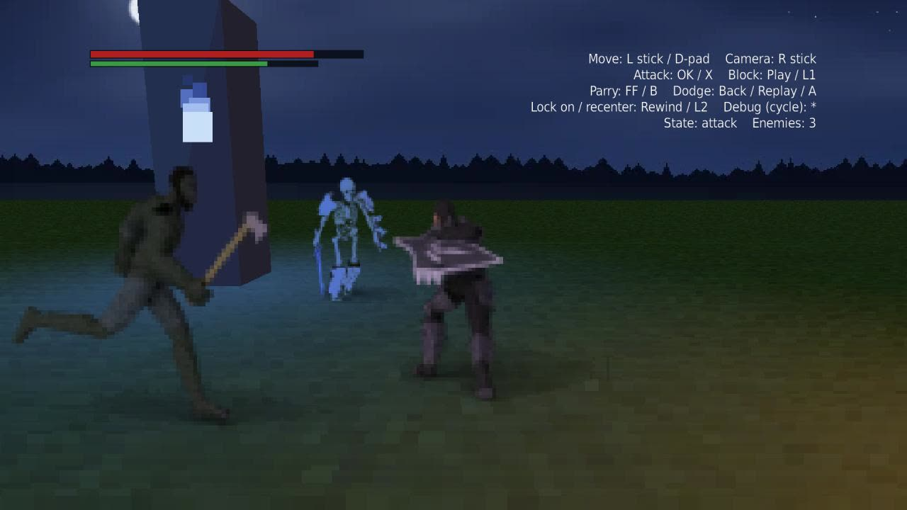 |
| [`fighter`](https://github.com/markwpearce/brighterscript-game-engine/tree/main/examples/fighter) | A two-player fighting game (work in progress, issue #295): one controller per player, 60 Hz frame data, hitboxes and hurtboxes, blocking, hit-pause, a parallax stage and a best-of-3 HUD | 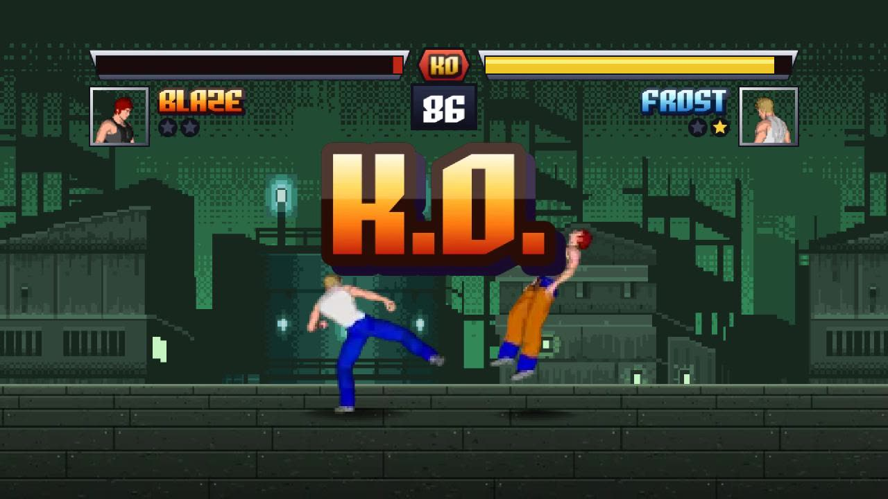 |
| [`platformer`](https://github.com/markwpearce/brighterscript-game-engine/tree/main/examples/platformer) | A side-scrolling, multi-level platformer: gravity, jumping and collision *resolution* built on the engine's detection-only colliders, a level from a [Tiled](https://www.mapeditor.org/) map, sound, particles and a full `BGE.UI` menu and HUD | 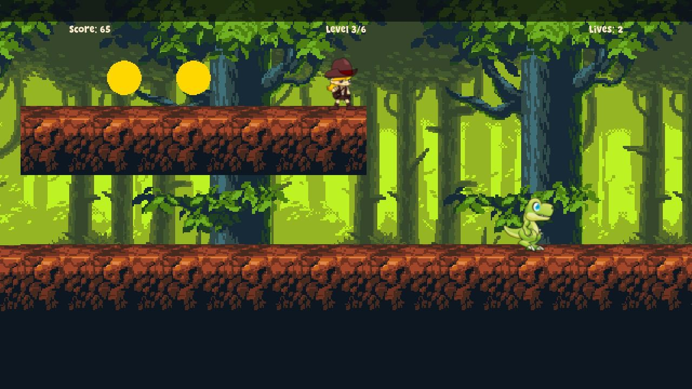 |
| [`rpg`](https://github.com/markwpearce/brighterscript-game-engine/tree/main/examples/rpg) | A top-down RPG: an auto-tiled town and castle built from character-grid maps, movement that slides along walls, props you walk in front of and behind, and fade transitions between areas | 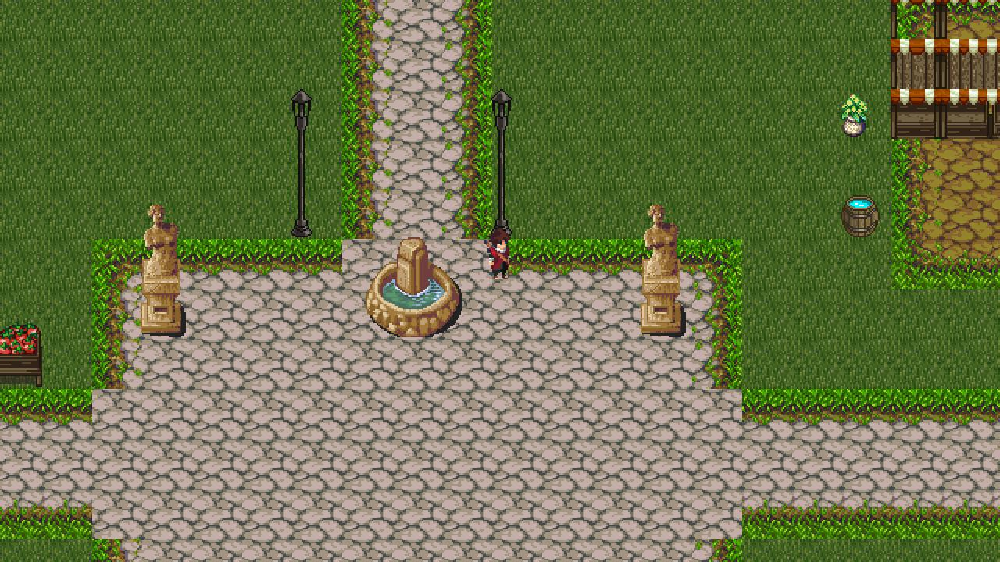 |
| [`visualnovel`](https://github.com/markwpearce/brighterscript-game-engine/tree/main/examples/visualnovel) | *The Mutiny*, a branching sci-fi visual novel: portraits, choices, flags, an inventory and saves | 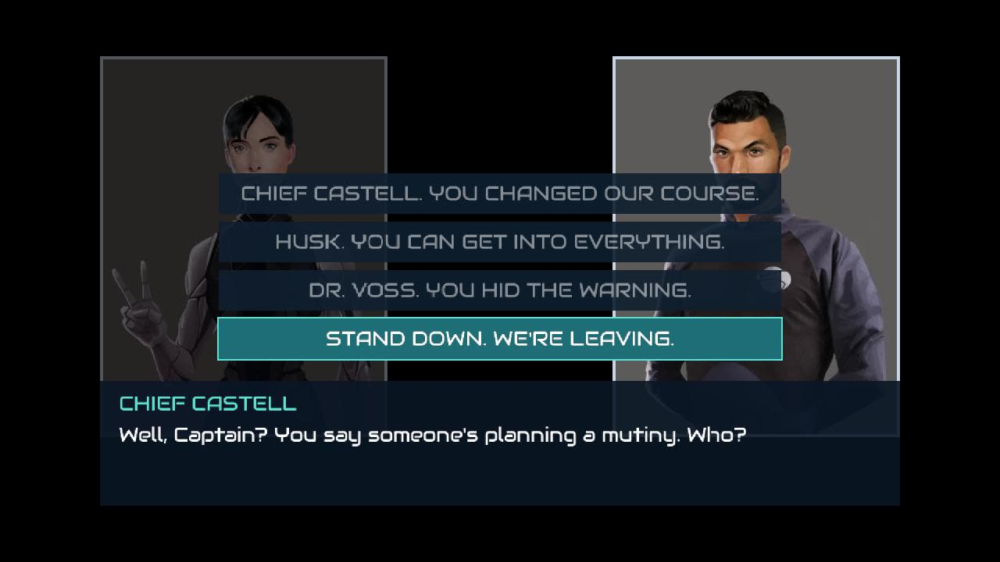 |
| [`asteroids`](https://github.com/markwpearce/brighterscript-game-engine/tree/main/examples/asteroids) | A complete 2D game: movement, bullets, collisions, explosions and sound | 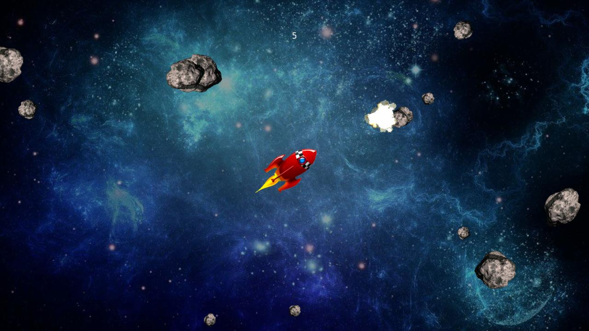 |
| [`breakout`](https://github.com/markwpearce/brighterscript-game-engine/tree/main/examples/breakout) | Bricks, a paddle and a ball, with a score and lives HUD | |
| [`pong`](https://github.com/markwpearce/brighterscript-game-engine/tree/main/examples/pong) | Classic Pong, playable with a 2D or 3D camera | |
| [`snake`](https://github.com/markwpearce/brighterscript-game-engine/tree/main/examples/snake) | Grid-based movement and a growing collision shape, in 2D and 3D | 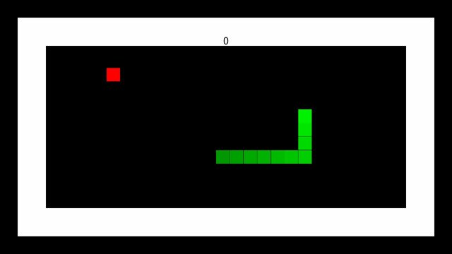 |

**Demos**

| Example | What it shows | |
| --- | --- | --- |
| [`quickstart`](https://github.com/markwpearce/brighterscript-game-engine/tree/main/examples/quickstart) | The minimal `MainScene`/`Player` example from above | |
| [`3d`](https://github.com/markwpearce/brighterscript-game-engine/tree/main/examples/3d) | Images, text, textured `.obj` and `.stl` models, cubes, circles, polygons and trees in 3D, one scene each | 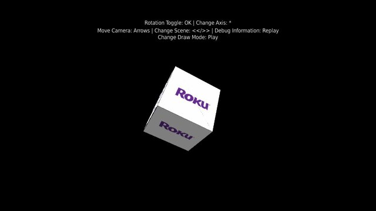 |
| [`terrain`](https://github.com/markwpearce/brighterscript-game-engine/tree/main/examples/terrain) | A 3D world with ground planes, a skybox, walls, trees and guards | 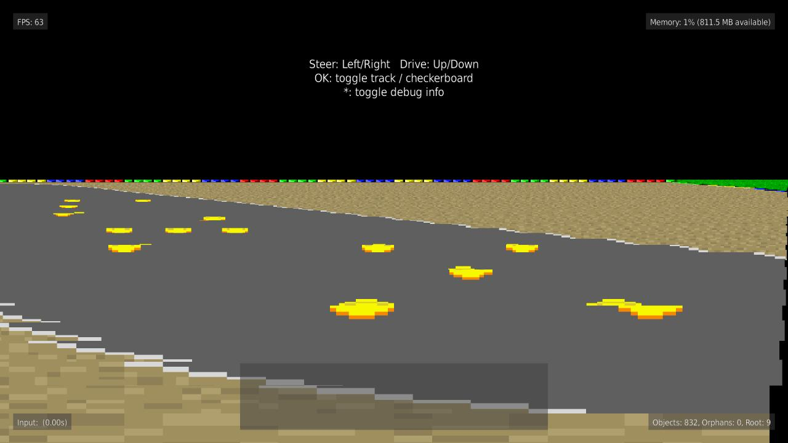 |
| [`collisions3d`](https://github.com/markwpearce/brighterscript-game-engine/tree/main/examples/collisions3d) | Sphere and box colliders in 3D | |
| [`depthsort`](https://github.com/markwpearce/brighterscript-game-engine/tree/main/examples/depthsort) | How depth sorting orders overlapping 3D objects | |
| [`particles`](https://github.com/markwpearce/brighterscript-game-engine/tree/main/examples/particles) | Particle emitters: lines, rectangles, images, animated images, moving emitters and bursts | |
| [`pixels`](https://github.com/markwpearce/brighterscript-game-engine/tree/main/examples/pixels) | A tour of 2D drawables: polygons, rectangles, circles and sprites, one scene each | |
| [`parallax`](https://github.com/markwpearce/brighterscript-game-engine/tree/main/examples/parallax) | Parallax scrolling layers | |
| [`tweens`](https://github.com/markwpearce/brighterscript-game-engine/tree/main/examples/tweens) | `BGE.TweenManager`: position, scale and color tweens with easing | |
| [`canvas`](https://github.com/markwpearce/brighterscript-game-engine/tree/main/examples/canvas) | The engine's canvas and renderer as a standalone drawing surface | |
| [`navigation`](https://github.com/markwpearce/brighterscript-game-engine/tree/main/examples/navigation) | Four agents path through a maze with `BGE.NavGrid`, re-planning as doors open and close | |
| [`story`](https://github.com/markwpearce/brighterscript-game-engine/tree/main/examples/story) | A branching story played as plain text and buttons | |
| [`ui`](https://github.com/markwpearce/brighterscript-game-engine/tree/main/examples/ui) | UI widgets: an analog cursor, nine-patch and image backgrounds, select styles and text input | 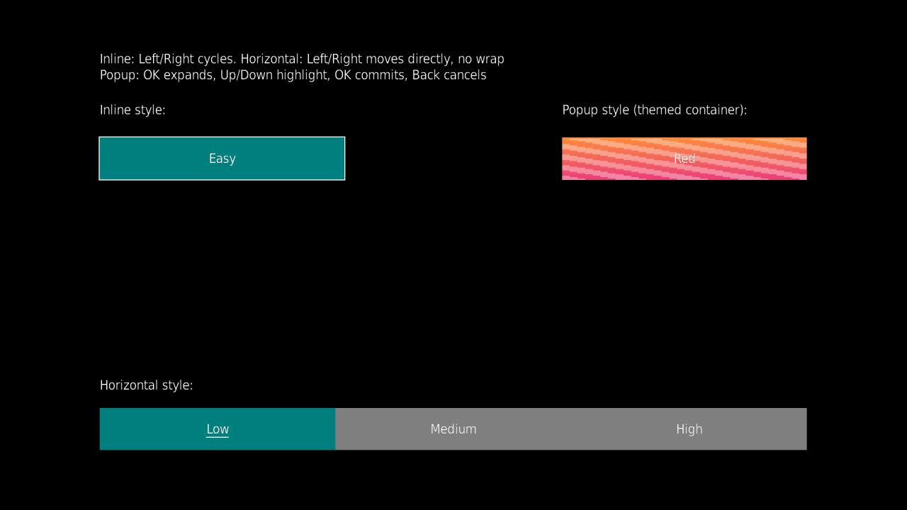 |
| [`controller`](https://github.com/markwpearce/brighterscript-game-engine/tree/main/examples/controller) | Phones and gamepads as controllers, one player per device, joined by QR code | |
| [`audio`](https://github.com/markwpearce/brighterscript-game-engine/tree/main/examples/audio) | Sound effects and background music | |
| [`loading`](https://github.com/markwpearce/brighterscript-game-engine/tree/main/examples/loading) | Loading local and remote assets behind a loading screen, including failures | |
| [`http`](https://github.com/markwpearce/brighterscript-game-engine/tree/main/examples/http) | URL requests with loading, success and error states, against a public trivia API | |
| [`hybrid`](https://github.com/markwpearce/brighterscript-game-engine/tree/main/examples/hybrid) | The engine's `Draw2D` rendering inside a SceneGraph app | |
| [`scenegraph`](https://github.com/markwpearce/brighterscript-game-engine/tree/main/examples/scenegraph) | The engine's SceneGraph shape components, with no `roScreen` or game loop | |
| [`rendererTest`](https://github.com/markwpearce/brighterscript-game-engine/tree/main/examples/rendererTest) | A test harness for the renderer: lighting, concave polygons, voxel terrain and more | |

Scaffold a new example (manifest, icons/splash, `package.json`, a minimal `MainScene`) with:

```
npm run create-example -- <name> ["Display Title"]
```

## Cloning and Running Examples

The BrighterScript Game Engine public repository is on [Github](https://github.com/markwpearce/brighterscript-game-engine/)

Clone the project:

```
git clone https://github.com/markwpearce/brighterscript-game-engine.git
```

This project includes various example Roku apps in the `examples` directory. To run them, you will need a Roku and have it set up properly for doing development. See: https://developer.roku.com/en-ca/docs/developer-program/getting-started/developer-setup.md.

To run the examples:

Install dependencies:

```
cd brighterscript-game-engine
npm install
npx ropm install
```

You will need to set up each project in the examples directories. You can do this by using this script:

```
npm run prepare-examples
```

### Build from the command line:

You can manually build the examples from the command line and manually add the zip files to your Roku:

```
npm run build-examples
```

The above command will generate example .zip files like `./examples/asteroids/out/bge-asteroids.zip`

To build one example and run it on your Roku in one step, put `ROKU_HOST` and `ROKU_PASSWORD` in a `.env` file at the repo root, then pass the example's folder name and any deep-link params:

```
npm run run-example -- rendererTest demo=lighting
```

### Open the Workspace in VS Code:

We recommend you install the great [Brightscript Language VSCode Extension](https://marketplace.visualstudio.com/items?itemName=RokuCommunity.brightscript).

Create/edit a `.env` file to specify the details for you target Roku device:

```env
ROKU_USERNAME=<roku development username - default is rokudev>
ROKU_PASSWORD=<roku development password>
ROKU_HOST=<local IP address of the target roku>
```

Then simply run one of the Debug configurations from the Debug tab.

## Installation

Add it as a dependency and install with `ropm`:

```
npm install brighterscript-game-engine
ropm install
```

By default, `ropm` renames every package's namespace to avoid collisions - so without any extra config, you'd need to reference the engine through its installed name, e.g. `new brighterscriptgameengine.BGE.Game(...)`.

To use the engine directly as `BGE.*` (as shown throughout this README and the examples), add `ropm.noprefix` for it to your **own** project's `package.json` - this is a per-consumer opt-out, safe to use because `BGE` is this engine's own deliberate top-level namespace, not an auto-generated one:

```jsonc
{
  "ropm": {
    "noprefix": ["brighterscript-game-engine"]
  }
}
```

Also add the standard `roku_modules` diagnostic filter to your `bsconfig.json`, the usual setup for any project with ropm dependencies (this engine's own `bsconfig.base.json` does the same for `rodash`):

```jsonc
{
  "diagnosticFilters": [
    { "files": "**/roku_modules/**" }
  ]
}
```

Without it, `bsc --validate` reports about 20 errors inside the installed engine, none in your own code: bsc's parser rejects the numeric `.toStr()` calls its own transpiler writes ([rokucommunity/brighterscript#524](https://github.com/rokucommunity/brighterscript/issues/524)), and the engine's generated typedefs import `rodash.d.brs`, which doesn't exist ([rokucommunity/brighterscript#2003](https://github.com/rokucommunity/brighterscript/issues/2003)).

Use `brighterscript` 1.0.0-alpha.53 or later. Older versions report a false `argument-type-mismatch` in your own code when you pass a `GameScene` or `GameEntity` subclass to the engine ([rokucommunity/brighterscript#1758](https://github.com/rokucommunity/brighterscript/issues/1758), fixed in alpha.53).

## Documentation

Documentation can be found [here](https://markwpearce.github.io/brighterscript-game-engine)

## Acknowledgements

This project was originally forked from [Roku-gameEngine](https://github.com/Romans-I-XVI/Roku-gameEngine) by Austin Sojka, and converted into BrighterScript. This work owes a lot to this original project!

Thanks also to:

- [RokuCommunity](https://github.com/rokucommunity) for [BrighterScript](https://github.com/rokucommunity/brighterscript), [bslint](https://github.com/rokucommunity/bslint), [roku-deploy](https://github.com/rokucommunity/roku-deploy), and the rest of the tooling that makes this project possible.
- [Marcelo Lv Cabral](https://github.com/lvcabral) for his work on the Roku/BrightScript community and tooling, including the [BrightScript Simulator](https://github.com/lvcabral/brs-desktop) this engine supports developing against.
