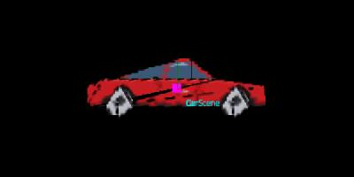
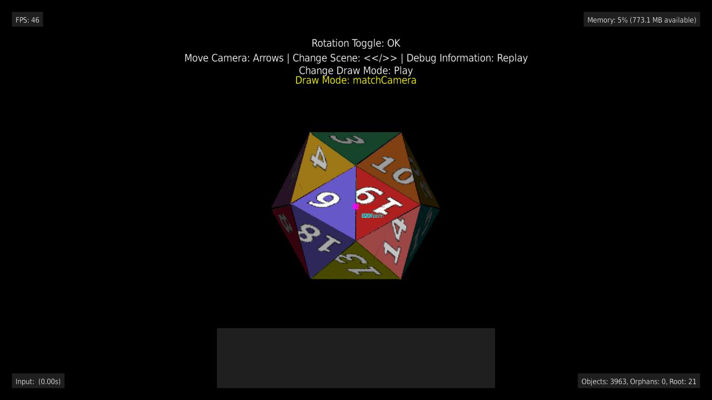

# Drawables and SceneObjects

This is a reference for the visual side of BGE: every `Drawable` subclass, the `SceneObject` each
one registers with the `Renderer`, and how the `Renderer` actually turns a scene full of
`SceneObject`s into pixels every frame. Read [Building a Game with BGE](/game-engine-overview) first
if you haven't - this guide assumes you already know how a `Drawable` attaches to a `GameEntity`.

## The pipeline, in one sentence

A `Drawable` doesn't draw itself. `GameEntity.addDrawable(name, drawable)` attaches it, and once per
frame `Drawable.addToRenderer(rendererObj)` registers a matching `SceneObject` with the `Renderer` -
from then on, the `Renderer` owns drawing it, not the `Drawable`. The `Drawable` still computes its
own transformation matrix from `offset`/`rotation`/`scale` (see `Drawable.computeTransformationMatrix`),
but the actual per-frame draw call, camera-relative positioning, and draw-mode handling all live on
the `SceneObject` side.

A `Drawable` doesn't strictly need a `GameEntity` - pass `invalid` as its owner to draw it straight
through a standalone `Renderer`, with no `Game` at all:

```brighterscript
renderer = new BGE.Renderer(myBitmap)
box = new BGE.DrawableRectangle(invalid, 40, 20, {offset: BGE.Math.VectorOps.create(100, 50, 0)})
box.addToRenderer(renderer)
renderer.render()
```

It then behaves as if owned by an entity at the world origin with no rotation and a scale of 1, so
its `offset` is its world position. Anything that needs a `Game` quietly does nothing instead:
logging, pausing an animation while the game is paused, and a `DrawableOrientedSprite` picking its
facing from the game camera. A `DrawableText` with no font uses the system default font.

## Every Drawable / SceneObject pair

| Drawable             | SceneObject             | What it draws                                                              |
| --------------------- | ------------------------ | --------------------------------------------------------------------------- |
| `Image`               | `SceneObjectImage`       | A single bitmap region - the basic sprite.                                  |
| `Sprite`              | `SceneObjectImage`       | An `Image` subclass that indexes into a sprite sheet by frame number.        |
| `AnimatedImage`       | `SceneObjectImage`       | A `Sprite` that advances its own frame index over time.                     |
| `DrawableRectangle`   | `SceneObjectRectangle`   | A filled and/or outlined rectangle.                                         |
| `DrawableCircle`      | `SceneObjectCircle`      | A filled and/or outlined circle - foreshortens into an ellipse when oriented in 3D. |
| `DrawableSphere`      | `SceneObjectCircle`      | A `DrawableCircle` that always renders as an undistorted circle, regardless of camera angle. |
| `DrawableOrientedSprite` | `SceneObjectImage`   | A `Sprite` that swaps its active animation based on the camera's angle to the entity, faking a Doom-style billboard sprite. |
| `DrawablePolygon`     | `SceneObjectPolygon`     | An arbitrary filled or outlined polygon.                                    |
| `DrawableLine`        | `SceneObjectLine`        | A single line segment between two points.                                   |
| `DrawableText`        | `SceneObjectText`        | Text rendered with a `roFont`.                                              |
| `Model3d`             | `SceneObjectModel`       | A triangle-mesh 3D model (loaded via `Game.load3dModel`, see `STLParser`).   |
| `DrawablePlane`       | `SceneObjectPlane`       | A textured ground/floor plane, rendered with a Mode-7-style perspective warp (see below). |
| `DrawableParallaxLayer` | `SceneObjectParallaxLayer` | A scrolling/tiling background (or foreground) layer that moves at a configurable fraction of the camera's movement. |
| `DrawableParticles`   | `SceneObjectParticle`    | A whole emitter's worth of simulated particles (lines, rectangles, or images), drawn through one `SceneObject` for the entire emitter (see below). |
| _(billboard drawables, e.g. images used with `directToCamera`/`directScaled` draw modes)_ | `SceneObjectBillboard` | Always faces the camera regardless of its own rotation. |

Every `SceneObject` subclass lives under `src/source/engine/renderer/sceneObjects/`. If you're
adding a new visual primitive, the pair goes together: a `Drawable` subclass that computes its own
geometry/transform, and a `SceneObject` subclass whose `addToRenderer` call the `Drawable` invokes.

## Rectangles

`DrawableRectangle` is the primitive to reach for when you want a solid block of color - a paddle, a
brick, a health bar, a HUD panel. `GameEntity.addRectangle` builds and attaches one in a single call:

```brighterscript
' a 150x20 white paddle, drawn from the entity's position
m.addRectangle("body", 150, 20, {color: BGE.ColorsRGB.White})
```

`color` and `outlineRGBA` are **packed RGB** (`0xRRGGBB`), which is what every `Drawable` takes -
`BGE.ColorsRGB` is the named-color enum in that format, and `alpha` is a separate field. That's a
different format from the packed **RGBA** (`0xRRGGBBAA`) that the `Renderer.draw*` calls and
`BGE.Colors` use, and mixing the two up gives you a plausible-looking wrong color rather than an
error.

A rectangle is anchored at its **top left corner** by default (anchor `(0, 0)`) and extends right
and downwards on screen, the same as an `Image`. Call `setAnchor(x, y)` with normalized 0-1
coordinates to pivot around a different point instead - `setAnchor(0.5, 0.5)` centers it on the
entity's position, `setAnchor(0.5, 1)` plants its bottom edge there (handy for a sprite that should
grow from the ground up rather than from its center). Every `Drawable` with a rectangular
width/height (`Image`, `Sprite`/`AnimatedImage`, `DrawableRectangle`, `DrawableText`) supports this
the same way. Without `setAnchor()`, nothing changes - offsetting the drawable by half its size to
fake a centered anchor still works exactly as before:

```brighterscript
cornerOffset = BGE.Math.VectorOps.create(-width / 2, height / 2)
m.addRectangle("body", width, height, {color: BGE.ColorsRGB.Yellow, offset: cornerOffset})
' a RectangleCollider covers the same area for the same offset, so the two line up
m.addRectangleCollider("body", width, height, cornerOffset.x, cornerOffset.y)
```

To resize one later, call `setSize(width, height)` rather than assigning to `width`/`height`
directly (they're deliberately not public). A resize isn't *movement*, so the renderer's
dirty-checking can't see it - `setSize` calls `Drawable.invalidateGeometry()`, which bumps a
`geometryVersion` the `SceneObject` compares against to know it must recompute projected geometry
even though nothing moved. Any `Drawable` that changes shape in place should do the same.

### Outlines

Setting `outlineRGBA` on **any** billboard drawable - a rectangle, a polygon, an image, text -
strokes an outline around it. There's no separate on/off flag: a color means yes, `invalid` (the
default) means no, and the renderer skips all outline work when there isn't one. `outlineWidth` sets
the thickness in pixels.

```brighterscript
' a lime rectangle with a 2px white border
m.addRectangle("brick", 112, 30, {
  color: BGE.ColorsRGB.Lime,
  outlineRGBA: BGE.ColorsRGB.White,
  outlineWidth: 2
})

' outline only, no fill - needs an outline color, or nothing is drawn at all
m.addRectangle("frame", 200, 100, {filled: false, outlineRGBA: BGE.ColorsRGB.Cyan})
```

The stroke lives on `SceneObjectBillboard`, which draws it over the top of the fill each frame along
the object's canvas corner points. Two consequences worth knowing:

- The outline is stroked in **canvas space**, so it stays a constant width rather than warping with
  perspective in the `oriented` draw modes. For a 1-2px stroke that generally looks better than the
  alternative, but it does mean an outline isn't baked into the cached temp bitmap and is re-stroked
  on every frame - which is why it's opt-in via `outlineRGBA`.
- A `SceneObject` whose shape isn't a single quad has to opt out by returning `invalid` from
  `getOutlineCanvasPoints()`, which is what `SceneObjectModel` does - outlining a triangle mesh means
  the `wireFrame` draw modes, not this. `SceneObjectPolygon` overrides the same hook to stroke along
  its own point list instead of the inherited quad.

In the `wireFrame` draw modes the outline *is* the entire drawing, so it's stroked once by
`drawToCanvas` and skipped by the hook. Those modes fall back to the fill color when no `outlineRGBA`
is set, which is why they look the same as they always did.

### How a rectangle is drawn, and why it's a billboard

`SceneObjectRectangle` extends `SceneObjectBillboard`, so a rectangle orients and foreshortens in 3D
just like an image (see `examples/3d`'s RectanglesScene, which cycles a ring of panels through every
draw mode). But unlike an image it has no texture to sample - it's one flat color - so it never uses
the inherited **pinned-corners** path: filling the projected quad produces identical pixels for far
less work, and `DrawableRectangle` never has to hold a bitmap of its own. That's how
`SceneObjectPolygon` draws, for the same reason.

It does still cache that fill into a **temp bitmap** in the oriented draw modes, exactly like a
polygon does. Filling a rotated quad means rasterizing two triangles through scratch bitmaps, which
is far too expensive to repeat every frame for something that hasn't moved - skipping the cache here
cost `examples/3d`'s RectanglesScene about two thirds of its frame rate (22 FPS vs 63) before it was
put back. Whether a `SceneObject` caches a given draw mode is `usesTempBitmap(drawMode)`, which
`SceneObjectRectangle` overrides to also require `filled` - an outline-only rectangle has no fill
worth caching.

In the direct (billboard) draw modes with no rotation - which is the 2D case, since a `Camera2d`
resolves `matchCamera` to `directToCamera` - it takes a shorter path still, going out as a single
`DrawRect` with no triangle rasterization and no bitmap at all. That's the path `examples/breakout`
runs on for its paddle, ball and every brick.

Keeping the billboard base (rather than making a rectangle a 4-point `DrawablePolygon`) is what buys
the rest: backface culling and per-face `isShaded` shading, both of which need the surface normal a
quad has and an arbitrary polygon doesn't; the direct/billboard draw modes, which
`SceneObjectPolygon` ignores entirely; and a frustum check over the 4 already-computed world corners
instead of `SceneObjectPolygon.getPositionsForFrustumCheck`'s scan-every-vertex bounding cube (whose
8 corners collapse to the same 4 points for a flat quad anyway - pure overhead here).

## Circles and Spheres

`DrawableCircle` is a filled (and optionally outlined) circle. `GameEntity.addCircle` builds and
attaches one the same way `addRectangle` does, just with a radius instead of a width/height:

```brighterscript
' an 80-radius red circle with a white outline
m.addCircle("body", 80, {color: BGE.ColorsRGB.Red, outlineRGBA: BGE.ColorsRGB.White, outlineWidth: 2})
```

Like a rectangle, a circle is anchored at the top left of its bounding square by default and
extends `radius * 2` right and down - `setAnchor`/`setSize`-style resizing works the same way too,
via `setRadius(radius)` rather than assigning `radius` directly (a resize isn't movement, so it has
to call `invalidateGeometry()` for the same reason `DrawableRectangle.setSize` does).

Where a circle differs from a rectangle is *how* it's drawn - it has no cheap way to fill itself,
so it uses two different techniques for its fill and its outline:

- **Fill**: a texture blit, not a rasterized shape. `Renderer.getCircleResource()` rasterizes a
  circle once (lazily, the first time anything asks for it) and every `DrawableCircle`/
  `DrawableSphere` in that `Renderer` shares the same bitmap - `SceneObjectCircle` just returns a
  region of it from `getRegionWithIdToDraw()`, exactly the way `SceneObjectImage` returns a region
  of the bitmap its `Image` was constructed with. This gets the same pinned-corners warp,
  color-tinting, and temp-bitmap caching an `Image` gets in the oriented draw modes, for free.
- **Outline**: computed fresh, not baked into the texture. `outlineSegments` (default 24) points
  are placed around the ellipse inscribed in the object's own already-transformed quad -
  `SceneObjectCircle.getOutlineCanvasPoints()` derives the ellipse's two axes directly from the
  quad's own corner vectors, so the outline automatically foreshortens along with the fill in the
  oriented draw modes without a second world-to-canvas transform pass.

A texture-backed fill means a circle pays the same **pinned-corners** cost an `Image` pays in the
oriented/solid draw modes - real per-pixel perspective warping, not the cheap flat 2-triangle fill
`DrawableRectangle`/`DrawablePolygon` get away with, since neither of those has a texture to sample.
`SceneObjectCircle` opts `solid`/`solidDrawBackFace` into the same temp-bitmap caching the oriented
modes already get, by overriding `usesTempBitmap()` (the same extension point
`SceneObjectRectangle` overrides for its own reason - skipping the cache for an unfilled
rectangle), since - unlike `DrawableRectangle`, whose solid-mode fill is cheap enough not to need
it - a circle's solid fill is exactly as expensive as its oriented fill.

`DrawableSphere` is a `DrawableCircle` that forces `drawMode = SceneObjectDrawMode.directScaled` in
its own constructor, so it renders identically in every way except one: it never turns to face a
direction and never foreshortens into an ellipse, because a sphere looks the same from every angle.
No separate `SceneObjectSphere` class exists for this - `SceneObject.getActualDrawMode()` only
resolves the `matchCamera` default through the camera, so any other explicit `drawMode` (this one
included) is used exactly as given. `examples/3d`'s CirclesScene puts a ring of alternating
`CirclePanel`/`SpherePanel` entities side by side, so orbiting the camera shows the difference
directly: the circles turn edge-on and thin out, the spheres next to them don't move at all.

`DrawableOrientedSprite` is a `Sprite` that fakes full 3D orientation the way classic
Doom/Duke3D monster sprites do: instead of one animation per action, it registers one
animation per (elevation band, angle bucket) via `addOrientedAnimation()`/
`addElevationOrientedAnimation()`, and every frame swaps which one is actually playing
based on the angle between the camera and the entity - `GameEntity.addOrientedSprite`
builds one. Bucket 0 (of `numAngles`, default 8) is the entity's front facing the
camera, and buckets increase clockwise as viewed from above; `numElevationBands`
(default 1, meaning no vertical distinction) optionally adds a second axis for a sheet
that also draws a distinct top-down or bottom-up view. Every bucket needs its own real
art - there's no mirroring support (a negated-`scale.x` flip was tried and found not to
render correctly through `directScaled`'s blit path; see the spec's Non-goals). See
`examples/terrain`'s `Guard` entity for a runnable demo, and
`specs/2026-09-22-oriented-sprite-billboards-design.md` for the full design.

## SceneObjectDrawMode

Every `SceneObject` has a `SceneObjectDrawMode`, controlling how it reacts to the camera's rotation
and perspective:

| Draw mode                             | Behavior                                                               |
| -------------------------------------- | ------------------------------------------------------------------------ |
| `matchCamera`                          | Follows the camera's rotation/perspective like a normal 3D object.      |
| `directToCamera`                       | Always faces the camera (billboard), ignoring its own rotation.         |
| `directScaled`                         | Like `directToCamera`, but sized by camera distance - a Doom-style sprite. |
| `oriented` / `orientedDrawBackFace`    | Respects its own rotation in 3D, optionally drawing back faces.         |
| `wireFrame` / `wireFrameDrawBackFace`  | Outline-only rendering of the triangle mesh.                           |
| `solid` / `solidDrawBackFace`          | Filled triangle rendering.                                             |

This is what gives a fundamentally 2D-raster engine its pseudo-3D/billboard capability (see
`examples/3d`) - `examples/rendererTest` has a runnable demo per mode (`DemoList.bs`).

For a model, a face's front is the side it's wound counter-clockwise from - the usual .obj/.stl
convention, so its outside. The modes without `DrawBackFace` draw only faces turned toward the
camera, and `isShaded` shades each face - by how squarely it faces the camera, or by the scene's
lights once it has some (see [Lighting](#lighting)).

`matchCamera`, `directToCamera` and `directScaled` are the **screen-aligned** (billboard) modes -
`isScreenAlignedDrawMode()` - and they keep an object square to the screen instead of turning it
in 3D. `directScaled` is the Doom-sprite one: it faces the camera and its on-screen size comes
from how far away it is, *independently of its own rotation*. That independence is the whole
point, and it's why `SceneObjectBillboard` builds the quad from the camera's own right/up axes in
world space and then projects it (`updateCanvasPointsForCameraFacingQuad`), rather than measuring
the object's own projected quad - measuring the latter would fold the object's orientation into
its size, so a sprite turned edge-on would squash. For the same reason a screen-aligned object is
never backface culled: it has no face to turn away.
`BGE.getDrawModeName(drawMode)` gives you a mode's name, for debug overlays or for an example that
lets you cycle through them (`examples/3d`'s BaseScene displays it on screen).

## Lighting

A drawable with `isShaded = true` (models are shaded by default) is darkened by how it's lit. With
no lights, that's a headlight: each surface is as bright as it is square-on to the camera. Add
lights to light the scene from fixed directions and positions instead, in color:

```brighterscript
' a blue-ish sun, shining down and away from the camera (+y is up)
sun = new BGE.DirectionalLight(BGE.Math.VectorOps.create(-1, -1, -0.5), &h6080FF, 0.8)
game.addLight(sun)

' a red lamp that fades out 600 units away
lamp = new BGE.PointLight(BGE.Math.VectorOps.create(0, 60, 200), 600, BGE.ColorsRGB.Red, 1.5)
game.addLight(lamp)

' a little light everywhere, so nothing in shadow is flat black
game.addLight(new BGE.AmbientLight(BGE.ColorsRGB.White, 0.15))
```

There are three kinds:

| Light              | Lights a surface by                                                        |
| ------------------ | -------------------------------------------------------------------------- |
| `DirectionalLight` | how squarely it faces into `direction` (the way the light travels)         |
| `PointLight`       | how squarely it faces `position`, fading linearly to nothing at `range` (0 never fades) |
| `AmbientLight`     | nothing - every surface gets the same amount                               |

Colors are RGB (`0xRRGGBB`, `BGE.ColorsRGB`). Each light's `color * intensity` is added up per
channel, capped at full brightness, and multiplied into the surface's own color, so a red light on
a white wall makes it red, and on a blue wall leaves it as dark as `ambientBrightness` allows.
`Drawable.ambientBrightness` still applies, now per channel: it's the darkest any channel gets, so
lower it to 0 if your lights (an `AmbientLight`, say) should decide how dark shadows are.

Lights can be changed any time - move a lamp, change its color, set `enabled = false` - and
the renderer notices and relights whatever they reach. `game.removeLight(light)` and
`game.clearLights()` take them away again (clearing them all goes back to the headlight). Lights
belong to the game canvas's renderer, not a scene, so remove a scene's own lights in its
`onDestroy()`.

Ground planes take lights too: set `isShaded = true` on a `DrawablePlane`. A plane is flat, so
directional and ambient light it evenly - its cached drawing is just tinted as it's drawn, which
costs nothing extra. On a `tiledImage` plane, a point light with a `range` casts a pool of light on
the ground beneath it, as wide as its range reaches and fading out toward the edge. Pools are
blended over the texture (Roku can't multiply one image into another), so a bright pool fades the
texture toward the light's color; `lightPoolOpacity` (0.6 by default) caps how far, so the ground
still shows through. While a pool is in view, a light change redraws the plane rather than just
re-tinting it - see the cost note below. A `staticImage` or `color` plane, and a point light with
no `range`, fall back to measuring the light on the plane right under the camera, so the ground
brightens as you walk toward a lamp instead. Unlike other drawables, a plane with no lights isn't shaded at all.

> **Cost.** Lights are free while they stay still: objects keep their cached drawings until
> something moves. A light that moves or changes every frame relights everything it reaches
> every frame - about what it costs for those objects to rotate - so keep animated lights to
> the few that need it. A model with `useImpostor` (the default) keeps its drawing through
> small light changes - while each light has turned less than the quality level's
> `modelImpostorMaxAngleDegrees` and changed brightness by less than
> `modelImpostorMaxLightChange` since it was drawn - so a slowly moving lamp only redraws it
> now and then. A lamp that moves while its pool is on screen redraws the ground plane's pools
> and re-slices it, but not its texture, once the pool has drifted more than the quality level's
> `planeLightPoolMaxDriftPixels` or changed color by more than `planeLightPoolMaxLightChange`. Shading is per triangle, from each one's centre, so a point light very
> close to a large flat face can light its triangles noticeably differently. There's no
> shadowing: a surface facing a light is lit even when something stands in between.

`examples/rendererTest`'s Lighting demo (`--param demo=lighting`) cycles through these lights over
a sphere, a cube, a flat panel and a tiled ground plane.

## Draw-distance fade

With a `Camera3d`, nothing past the camera's draw distance is drawn. Instead of popping
out of view at that limit, objects fade out across the far end of it:

```brighterscript
camera = new BGE.Camera3d()
camera.maxDrawDistance = 1000
' fade across the last 20% (800-1000) instead of the default 15%
camera.drawDistanceFadeFraction = 0.2
game.setCamera(camera)
```

Set `drawDistanceFadeFraction = 0` for a hard cut-off. The fade multiplies whatever
`Drawable.alpha` you've set, so an image at alpha 128 halfway through the band draws at 64.

When the draw distance changes - a new render quality level, or your game changing
`maxDrawDistance` - the camera eases to the new distance over
`drawDistanceTransitionSeconds` (default 0.75), so distant objects fade in or out
gradually. Call `camera.snapDrawDistance()` after a camera cut to skip the transition.

Ground planes, skyboxes and parallax layers don't fade: they have no single distance from
the camera. Everything else fades by its nearest corner, so a long wall stays solid while
its near end is well inside the draw distance.

A ground plane always reaches the farthest any quality level would draw objects (1.5x
`maxDrawDistance` with the default presets), so objects fade out on the ground rather than
past its edge, and the horizon doesn't move when the quality level changes. Past the
default distance, the ground's texture gets a little softer instead of costing more memory.

## Occluders and visibility

A big opaque thing in a 3D scene (a building, a wall, a hill) hides whatever stands behind it.
Mark its drawable `isOccluder: true` and the renderer stops drawing everything it fully hides:

```brighterscript
class Chapel extends BGE.GameEntity

  override sub onCreate(args as roAssociativeArray)
    m.isStatic = true ' an occluder's owner never moves
    model = m.game.get3dModel("chapel")
    m.addDrawable("chapel", new BGE.DrawableModel(m, model, {
      isOccluder: true,
      drawMode: BGE.SceneObjectDrawMode.solid
    }))
  end sub

end class
```

Game code can ask what happened to an entity last frame, for example to skip purely visual
work for a tree nobody can see:

```brighterscript
override sub onUpdate(dt as float)
  if not m.isOnScreen()
    return ' hidden or off camera: skip the sway animation
  end if
  m.animateSway(dt)
end sub

' Or tell the reasons apart:
if m.getVisibility() = BGE.VisibilityState.occluded
  ' something solid is in front of it
end if
```

`getVisibility()` (on `GameEntity`, `Drawable` and `SceneObject`) returns a `BGE.VisibilityState`:
`visible` (drawn), `occluded` (hidden behind an occluder), `offCamera` (outside the camera's view)
or `unknown` (no drawables, or not drawn yet). An entity with several drawables reports the
most visible one, in the order visible > occluded > offCamera > unknown. `isOnScreen()` is true for
`visible` and `unknown`. Nothing in the engine skips an entity's `onUpdate()` or collisions for
you; this is only a signal.

To see what's going on, call `game.debugDrawOcclusion(true)` (it shades the canvas areas the
occluders cover and draws a red box around each hidden object), and read `renderer.getOccludedCountLastFrame()`. The `terrain` example has a
static chapel that hides the trees behind it, and OK toggles occlusion in its `WorldScene`.

A few things the renderer enforces, which are easy to trip over:

- The drawable must be **fully opaque** (an image with no transparent pixels, a model with no
  translucent colors). The engine can't check this, so anything behind a see-through occluder
  would vanish.
- The owner must be `isStatic`, and the drawable's draw mode must be an oriented one
  (`oriented`, `orientedDrawBackFace`, `solid`, `solidDrawBackFace`). Screen-aligned modes
  (`matchCamera`, `directToCamera`, `directScaled`) are ignored as occluders, and so is any
  occluder under a `Camera2d`.
- `isOccluder` can be turned on or off at any time, e.g. when a wall becomes see-through.
- A standalone `SceneObject` with no owner registers itself with `renderer.markOccluder()`.
- Occlusion is conservative: an object is only hidden when it is clearly behind the occluders,
  with a small safety margin, so a borderline object still draws. Screen-aligned fixed-size
  objects, text and particles are never hidden.
- An occluder draws like anything else, cached bitmaps and coarse fills included. While it (or
  the camera) moves, the area it claims to cover shrinks by the largest error those shortcuts
  can make, so it rarely hides something it doesn't actually paint over (a non-convex model
  can still briefly over-claim near its silhouette). An object near an
  occluder's edge can therefore stay drawn while the camera moves, and is hidden again once it
  stops.
- `renderer.occluderDrawPolicy` changes that trade-off. The default,
  `BGE.OccluderDrawPolicy.fastShrink`, is the behaviour above. `exact` makes occluders always
  draw exactly and claim their whole outline (slower to draw, hides the most).
  `fastExactClaim` keeps the shortcuts but still claims the whole outline, so an object just
  behind an occluder's edge can vanish for a few frames while the camera moves.
- Tuning knobs on the `Renderer`: `occlusionCullingEnabled` (default `true`), `occlusionBandCount`
  (45 horizontal bands), `maxOccluders` (32, the largest on screen are kept) and `occlusionMargin`
  (2.0 pixels of safety around each object). With no occluders registered the whole feature
  costs nothing.
- Occlusion has its own cost: while the camera moves, the occluders are re-projected and each
  object is re-judged every frame. It pays off when what it hides is expensive to draw (warped
  textures, models), and barely breaks even when the hidden objects are cheap sprites.
  `renderer.getOcclusionMsLastFrame()` and `renderer.getOcclusionTestsLastFrame()` (objects
  that needed the full test) show what it costs you; compare frame times with
  `occlusionCullingEnabled` on and off.

## How `Renderer.render()` actually draws a frame

`Renderer.render()` (`engine/renderer/Renderer.bs`) runs once per frame, per canvas (there's a
separate `Renderer` for the game canvas and the UI canvas). It does three things, in order:

1. **`updateSceneObjects()`** - recomputes world positions and camera-distance for every registered
   `SceneObject` (see "Per-object update", below).
2. **Sort by depth** - `m.sceneObjects.sortBy("negDistanceFromCamera")`, so farther objects draw
   first and nearer objects draw over them (simple painter's algorithm, no z-buffer).
3. **Draw in two passes**: every `SceneObjectPlane` first, then every other enabled `SceneObject`
   whose `negDistanceFromCamera < 0` (i.e. in front of the camera). Planes are drawn first because
   they're meant to be a ground/floor - drawing them before anything else means normal
   painter's-algorithm depth sorting for everything else (which _does_ sort against the camera
   distance) still looks correct sitting on top of the plane. Objects hidden behind an occluder
   are skipped before this point (see "Occluders and visibility").

### Per-object update (`SceneObject.update`/`draw`)

`SceneObject.update(cameraObj)` and `.draw(rendererObj)` are called every frame for every object,
but most of the expensive work is skipped unless something actually changed:

- **`objMovedLastFrame = m.drawable.movedLastFrame(true)`** - `Drawable`/`Camera` use a
  `MotionChecker` (`utils/MotionChecker.bs`) for dirty-checking; if neither the object nor the
  camera moved since last frame, `update()` skips recomputing the transformation matrix and world
  position entirely.
- **`isPotentiallyOnScreen(cameraObj)`** - a cheap frustum check gate in `draw()`. If the object
  drew last frame **and nothing has moved since**, it skips straight to drawing; if the frustum
  *culled* it last frame and nothing has moved since, it stays culled without re-checking, which is
  what makes a static off-screen object free. A moving object always re-checks the frustum either
  way. Only a genuine cull latches this way: a draw that was attempted and failed is retried on the
  very next frame, because `findCanvasPosition()` and `performDraw()` are both
  transient-failure-prone and both already recover. A camera *projection* change - its frame size
  or field of view, neither of which counts as camera movement - lifts the latch too, via
  `Camera.projectionVersion`.
- **`findCanvasPosition(rendererObj, drawMode)`** - only re-run when `objMovedInRelationToCamera()`
  is true (the object or camera moved), there's no valid canvas position yet, or the camera's
  projection changed (`Camera.projectionVersion`, same signal as above). This is where a
  `SceneObject` subclass computes whatever camera-relative geometry it needs before drawing (e.g.
  `SceneObjectPlane` computes the frustum-to-plane intersection here - see below).
- **`performDraw(rendererObj, drawMode)`** - the actual draw call. Several `SceneObject` subclasses
  (`SceneObjectBillboard`, `SceneObjectPlane`) cache a rendered bitmap and reuse it across frames
  when nothing's moved, rather than re-rasterizing from scratch every frame - drawing that cached
  bitmap is far cheaper than recomputing the object's projected geometry and re-drawing it.

Two supporting pieces worth knowing about if you're touching rendering performance:

- **`TriangleCache`** caches rasterized triangle bitmaps - triangle drawing (`drawBitmapTriangleTo`,
  `drawPinnedCorners`) is comparatively expensive per call, since it checks out and rasterizes
  scratch bitmaps internally. Code that draws the same triangle-heavy shape every frame should
  render once into a cached bitmap and blit that, rather than redoing the full draw at 60fps -
  `examples/rendererTest/CornerPinGridTest.bs` is a worked example of this pattern (and of what
  happens without it: most of a 26-tile grid silently failed to render after the first few tiles).
- **`ScratchBitmapPool`** (`engine/renderer/ScratchBitmap.bs`) hands out reusable off-screen bitmaps
  for exactly this kind of intermediate rendering work, so it doesn't need to allocate a fresh
  `roBitmap` every frame. **Pooled bitmaps are handed out as-is, not cleared** - if you draw into
  one and don't cover its entire area, whatever was left over from its previous, unrelated use will
  still be there. Always `Clear()` a scratch region yourself before drawing into it unless you're
  certain your draw call will fully cover it.

### The cluster draw contract (`getPrimitiveCount`/`getPrimitiveDepth`/`drawPrimitive`/`participatesInOverlapDetection`)

`Renderer.computeOverlapClusters` (off by default) opts a renderer into detecting when two or
more `SceneObject`s' projected screen bounds actually overlap (`BGE.DepthSort`'s sort-and-sweep
broad phase plus a convex-hull narrow phase) and, for any multi-member cluster it finds,
interleaving their draws by depth instead of drawing each object atomically. That interleaving is
built on four small, overridable `SceneObject` methods:

- **`getPrimitiveCount()`** - how many separately-orderable pieces this object currently has. The
  base-class default (`1`) is correct for every billboard-family `SceneObject` - a quad, circle,
  piece of text, etc. is always one piece regardless of draw mode.
- **`getPrimitiveDepth(index)`** - the depth to sort primitive `index` by. The base-class default
  returns the object's own `negDistanceFromCamera`, correct for the single-primitive case. Every
  override must stay on the *same convention* - negative in front of the camera, ascending sort =
  farthest-first (matching `negDistanceFromCamera` and the main scene's own painter's-algorithm
  sort) - or its primitives will sort backwards against every other object's.
- **`drawPrimitive(rendererObj, index)`** - draws primitive `index` now. The base-class default
  delegates to the object's normal `performDraw()`, so a solo object's cluster-path draw and its
  normal draw path are the same call, not a second implementation to keep in sync.
- **`participatesInOverlapDetection()`** - whether this object is worth including in cluster
  detection at all. The base-class default (`true`) is correct for anything with real area, which
  the narrow phase can test via a convex hull of 3+ points.

A **solo cluster** (an object nothing else overlaps - still the overwhelming common case) draws
exactly as it does today: whole-object temp-bitmap caching, one `draw()` call, no primitive
enumeration. Only a genuine multi-member cluster pays for `getPrimitiveCount()`/
`getPrimitiveDepth()`/`drawPrimitive()` at all - `Renderer` collects every deferred cluster
member's primitives into one combined list (spanning every cluster drawn that frame, not scoped
per-cluster - harmless, since non-overlapping clusters were never going to visually interact
anyway), sorts it once by depth, and calls `drawPrimitive()` in that order.

`SceneObjectModel` is the one type that overrides all three draw-contract methods: it exposes its
per-face list (`m.modelCanvasFaces`, already rebuilt every frame by `updateCanvasPosition()`,
already correctly reflecting the resolved draw mode's backface-cull behavior) via
`getPrimitiveCount()`/`getPrimitiveDepth()`, and `drawPrimitive()` draws one face directly through
a shared `drawFaceToCanvas()` helper - deliberately bypassing its own whole-model temp-bitmap
cache, which aggregates every face in the model's own internal order and can't represent this
face being interleaved with a different object's primitives.

**Fixed** (was tracked as [#112](https://github.com/markwpearce/brighterscript-game-engine/issues/112)):
`updateCanvasPosition()`'s internal face sort is now `SortBy("priority", "r")` (descending, farthest
priority value first), matching `getPrimitiveDepth()`'s own farthest-first convention. The solo draw
loop (straight iteration over `modelCanvasFaces`, unchanged) and the cluster path now agree: a
model's self-overlapping faces paint farthest-first, nearest-last-on-top, whether it's drawn solo
or as part of a multi-member overlap cluster that frame.

`SceneObjectLine` and `SceneObjectPlane` both override `participatesInOverlapDetection()` to
return `false`. Neither is a correctness workaround - a line's bounding points are always exactly
its two endpoints, and a plane's default bounding point is a single point; neither can ever reach
the narrow phase's minimum of 3 hull points, so both were always going to fail cluster candidacy
regardless. The override just skips paying the broad-phase setup cost (screen-bounds projection,
hull construction, sort/sweep bookkeeping) for a check that was guaranteed to reject them anyway -
this matters in practice for a scene built from many line segments (e.g. `examples/3d`'s
`TreesScene`, each tree a bundle of `DrawableLine` branches), which would otherwise dominate the
cluster-candidate count for zero possible benefit.

See `specs/2026-08-16-depth-sort-plan-2-design.md` for the full design, and `examples/depthsort`'s
`ClusterVisualizerScene` for a runnable demo of interleaved draw order taking visible effect.

## Textured 3D models (`Model3d` / `OBJParser`)

An `.obj` model can carry diffuse textures, sampled via UV coordinates and affine-mapped onto each
triangular face (not perspective-correct - see the "Bitmap Triangle Warp" demo in `rendererTest` for
the underlying primitive, `Renderer.drawBitmapTriangle(To)`). Two ways to get textures onto a model:

- **Materials**: the `.obj` references a `mtllib <file>.mtl`, and each `usemtl <name>` line sets the
  material of the faces after it. Each material's `map_Kd <image>` is its texture, resolved relative
  to the `.mtl` file. Every distinct texture is loaded once. `examples/3d`'s `CarScene` (nine
  materials) and `D20Scene` (one) use this, as does `examples/terrain`'s chapel.
- **Explicit override**: pass `{texturePath: "pkg:/..."}` as the third argument to
  `Game.load3dModel(modelName, modelPath, options)` - every textured face uses it instead of its
  material's texture. Handy for a model that carries UV data but ships its texture separately, with
  no `mtllib` at all.

```brighterscript
' textures from the model's .mtl file:
game.load3dModel("car", "pkg:/models/car/car.obj")

' one texture for every face, whatever the .mtl says:
game.load3dModel("crate", "pkg:/models/crate.obj", {texturePath: "pkg:/sprites/crate.png"})
```

UVs outside 0..1 repeat the texture, the usual `.obj` convention for tiling a small texture across a
big face. A face with no texture of its own - no UV data on one of its corners, a material with no
`map_Kd`, or a texture that can't be found or loaded (a warning is logged) - is filled flat, in its
material's `Kd` color when it has one. The rest of the model stays textured; a load never fails over a
texture. Other `.mtl` properties (`map_Bump`, `Ks`/`Ns`, `d` transparency, `illum`) are ignored.





## Deep dive: `SceneObjectPlane` (`DrawablePlane`)

`DrawablePlane`/`SceneObjectPlane` render a textured, (mostly) infinite ground/floor plane -
`examples/terrain` is a small, playable demo of it (drive a camera around above a Mario Kart track
image, or toggle to a checkerboard). It works nothing like the other `SceneObject`s, which each
draw one small object; a plane covers the camera's entire view of the ground, so the implementation
is closer to a classic SNES "Mode 7" renderer than to a sprite draw call.

### The technique

Each frame, `SceneObjectPlane` (in `findCanvasPosition`, via `getPerspectivePointsByCamera`):

1. Casts a ray from each of the camera's four frustum corners and intersects each with the plane
   (`BGE.Math.intersectRayWithPlane`) - this gives the four world-space points where the camera's
   view "hits the ground" at its corners. When the camera isn't rolled, these rays are built fresh
   each frame using a true (`atan`-derived) vertical field of view rather than reusing
   `Camera3d.frustumRays` (which uses a cheaper linear approximation - accurate enough for frustum
   culling, but not for this plane's own edges; see "Roll" below for the rolled case, which builds
   its own rays too). Corners whose rays don't hit the plane at all
   (pointing above the horizon), or that hit it farther away than the plane draws, are placed
   instead on the plane at the camera's draw distance straight ahead, the full width of the
   view at that depth - the same depth every other object is clipped at, so nothing stands
   past the ground's far edge.
2. Converts those four world points into **texture pixel coordinates** via
   `BGE.Math.worldPointToTexturePixel` (see "Texture anchoring" below).
3. `populatePerspectiveBmp()` un-warps the resulting quad: it rotates/translates the *entire*
   source texture region so the quad's corner lines up correctly, then scales that into a
   rectangular "pre-perspective" bitmap - effectively turning "camera looking at a trapezoid on the
   ground" into "looking straight down at a flat rectangle."
4. `drawPerspectiveBmpSlicesToByCamera()` slices that pre-perspective bitmap into thin horizontal
   bands (`RenderQualitySettings.planeSliceCount`, 20-50 depending on the quality level), each
   drawn with one scaled blit. Each band's on-screen position comes from projecting its
   world-space boundary points through the camera's own perspective formula
   (the same math `Camera3d.worldPointToCanvasPoint` uses for every
   other 3D object) - bands near the camera land large near the bottom of the frame, bands near
   the horizon shrink toward it, which is what produces the perspective effect, and what keeps the
   ground aligned with any per-point-projected object (a billboard, say) at the same world
   position. Each band's source span is exactly the ground the camera shows across the frame at
   the band's mid depth. A single blit can't change its horizontal scale as depth changes, so a
   straight line on the ground is drawn as a short staircase whose steps grow toward the sides of
   the frame. The size of a band's step depends on how much deeper its far edge is than its near
   edge, so the bands are spaced to give every one the same far/near depth ratio. Raising
   `planeSliceCount` makes the steps smaller, at the cost of one more native draw call per band.

### Texture anchoring

The plane is mathematically infinite (`y=0`, extending forever in `x`/`z`), but by default
(`fillMode: staticImage`) its texture is a single finite bitmap region with no tiling - see
"Fill modes" below for `tiledImage`, which does tile.
`BGE.Math.worldPointToTexturePixel(worldPoint, textureCenterWorldPoint, textureWidth, textureHeight)`
anchors the texture's *center* pixel on wherever the plane actually sits in world space
(`textureCenterWorldPoint`, the plane entity's own world position) rather than on world `(0,0)` -
world points equal to the anchor map to the texture's center pixel, and points `n` units away map
`n` pixels away from center (1 world unit = 1 texture pixel, no additional scaling).

Practical implication: driving/looking far enough away from the plane's anchor point runs off the
edge of the texture. That's expected and handled correctly - `SceneObjectPlane.findCanvasPosition`
uses `BGE.Math.boundsOverlapRect` to skip drawing entirely once the camera's view can't possibly
overlap the texture at all (a cheap early-out), and for partial overlaps, the plane correctly shows
real texture on the side that's in-bounds and the renderer's background (transparent/black) on the
side that isn't - it does **not** wrap or repeat the texture to fill the screen.

### Fill modes (`DrawablePlane.fillMode`)

`DrawablePlane.fillMode` (a `BGE.PlaneFillMode`) picks how the plane's surface is filled, and planes
in different modes compose with each other through ordinary `addDrawable()` calls - stack a flat
color base, a tiled texture over it, and a one-off decal on top of both:

```brighterscript
groundPlaneDef = {normal: {x: 0, y: 1, z: 0}, point: {x: 0, y: 0, z: 0}}

' A flat green base layer - region is `invalid` since color fillMode ignores it
baseLayer = new BGE.DrawablePlane(m, invalid, groundPlaneDef, {fillMode: BGE.PlaneFillMode.color, color: BGE.ColorsRGB.Green})
m.addDrawable("GroundBase", baseLayer)

' A repeating grass tile on top of it
grassTile = CreateObject("roRegion", m.game.getBitmap("grass"), 0, 0, 64, 64)
grassLayer = new BGE.DrawablePlane(m, grassTile, groundPlaneDef, {fillMode: BGE.PlaneFillMode.tiledImage})
m.addDrawable("Grass", grassLayer)

' A one-off decal (e.g. a road) on top of both
roadRegion = CreateObject("roRegion", m.game.getBitmap("road"), 0, 0, 256, 256)
roadDecal = new BGE.DrawablePlane(m, roadRegion, groundPlaneDef, {fillMode: BGE.PlaneFillMode.staticImage})
m.addDrawable("Road", roadDecal)
```

- `color` fills the plane with `Drawable.color`/`alpha` and ignores `region` entirely - no texture,
  so it never "runs out" the way the other two modes can. This makes it the natural base/backdrop
  layer to add first.
- `tiledImage` treats `region` as a single repeating tile, seamlessly covering the ground out to
  `Camera3d.maxDrawDistance` in every direction - this is the tiling the "Texture anchoring" section
  above calls out as unavailable by default.
- `staticImage` (the default, and the only mode that existed before `fillMode` was added) is the
  finite decal described above: a one-off texture anchored at the plane's own world position -
  correct for something like a map/track texture, wrong for anything meant to repeat.

Layering order for planes at the same depth follows `addDrawable()` insertion order (the same
depth-sort tie-break every `SceneObject` uses) - add the base layer first, as in the example above,
so later calls draw on top of it.

`tiledImage` builds and caches a "supertexture" bitmap the first time it draws (lazily, per
`DrawablePlane` instance, and rebuilt only if `Camera3d.maxDrawDistance` changes afterward) by
tiling `region` across a grid roughly `2 * maxDrawDistance / tileSize` tiles per axis, where
`tileSize` is the tile's own smaller dimension. That means the tile count built up front - and so
the build cost and cached bitmap size - scales with `(maxDrawDistance / tileSize)²`. Pick a tile
size (and consider `maxDrawDistance`) with that in mind: a small tile paired with a large
`maxDrawDistance` builds a much bigger cached bitmap than a coarser tile would.

Note that `maxDrawDistance` itself may be silently capped below whatever you set it to: `Camera3d`
clamps it per-device (900 on the BrightScript Simulator and, pending real hardware testing, on
SD/HD devices too; effectively unlimited on FHD) every frame, so a plane's actual far distance and
supertexture size follow the capped value, not the requested one.

### Roll

`Camera3d.rollDegrees` (rotation about the camera's own forward axis) can't be represented by this
horizontal-band rasterizer directly - a tilted horizon isn't a stack of horizontal bands. Instead,
whenever `rollDegrees <> 0`, every step above runs against an *unrolled* ("level") camera enlarged
to cover the real frame's diagonal (`SceneObjectPlane.getRollCanvasSize`), using
`Camera3d.getLevelUpVector()`/`getLevelRightVector()` and a true, `atan`-derived field of view
(`getFovDegreesForCanvasSize`) for both axes. The resulting composite is then rotated by
`rollDegrees` about its own center and cropped back down to the real frame (`performDraw`) -
mathematically exact for a pure roll, since perspective division commutes with an in-plane
rotation about the optical axis. See `specs/2026-08-19-camera-roll-and-plane-horizon-design.md`
for the full design.

### Gotchas if you touch this code

- **Scratch bitmaps are pooled and not cleared** (see the `ScratchBitmapPool` note above) - this bit
  particularly hard here, because the visual symptom of *not* clearing looked exactly like the
  texture "wrapping/repeating" the further you got from its valid bounds. It wasn't a sampling-wrap
  bug at all: `populatePerspectiveBmp()`'s scratch region and `prePerspectiveBmp` are reused,
  uncleared pooled bitmaps, and once the camera's view moved mostly or entirely outside the
  texture's valid area, the rotated draw call landed off-canvas and left the *previous, unrelated
  frame's* leftover pixels showing through - which happened to look like the track's own curb
  pattern, because that's literally what it was. Both bitmaps must be `Clear()`-ed before drawing
  into them each frame.
- **Slice seams**: each ground band's two boundary points are projected to screen-space Y
  independently and rounded to whole pixels, so adjacent bands' rounded positions can disagree by
  a fraction of a pixel, leaving a thin black gap between them (worst near the bottom of the
  screen, where bands are tallest/nearest the camera). Each band is drawn a few pixels taller than
  its exact allotted position (`seamPadding`) so neighbors overlap slightly instead of gapping.
- **Camera-orientation coupling**: if you're building a "chase camera" or similar that follows a
  moving point, don't use `camera.setTarget(fixedPoint)` every frame if you want the camera to turn
  the way a driver's/person's head turns - `setTarget` points the camera *at* that fixed point,
  which orbits the camera around it as its own position changes, rather than rotating the camera's
  own view. Set `camera.orientation` directly from your desired look direction instead (see
  `examples/terrain/src/source/Scenes/MainScene.bs`'s `updateCameraOrientation`).

## Skybox (`DrawableSkybox` / `SceneObjectSkybox`)

`DrawableSkybox` renders a 360-degree panoramic texture that surrounds the camera, giving the impression
of a distant sky or environment infinitely far away. Unlike other drawables that move with the world, a
skybox is always centered on the camera and rotates with it. Attach one to an entity the same way as any
other drawable:

```brighterscript
' Create a skybox with a 360-degree panoramic image
region = CreateObject("roRegion", bmp, 0, 0, bmp.getWidth(), bmp.getHeight())
owner.addDrawable("sky", new BGE.DrawableSkybox(owner, region, {
  degreesPerFullWidth: 360.0,
  verticalDegreesCovered: 90.0
}))
```

The constructor takes an optional `args` object with two configurable fields:

- **`degreesPerFullWidth`** (default `360.0`): how many degrees of view angle the texture's full width
  represents. Set to `360` for a complete 360-degree panorama, or a smaller value if the texture covers
  a narrower field of view (e.g., `120` for a 120-degree wide-angle texture).
- **`verticalDegreesCovered`** (default `90.0`): how many degrees of vertical view angle the texture's
  full height represents. This controls how much of the sky above and below the horizon the texture fills.

`SceneObjectSkybox` renders in its own dedicated pass in `Renderer.render()`, before all other objects
(including planes). This ensures the skybox always draws behind everything else. A skybox never
participates in depth-sort or overlap-cluster detection—it's always drawn as a background layer.

Like `SceneObjectPlane`, `SceneObjectSkybox` handles `Camera3d.rollDegrees` (rotation about the camera's
forward axis) by rendering against an unrolled camera view and then rotating the composite. See
`specs/2026-08-19-camera-roll-and-plane-horizon-design.md` section D for the full mathematical
details of this render-then-rotate trick—the mechanism is the same, applied to the skybox's spherical
geometry instead of a planar ground.

**Note:** `Camera2d` does not support skyboxes; this feature is 3D-only (issue #65).

**Note:** unlike `SceneObjectPlane`, `SceneObjectSkybox` has no per-frame dirty-check caching yet—it
recomputes and re-blits its visible band every frame even when yaw/pitch/roll haven't changed. Correct,
just not optimized; tracked as a follow-up issue.

## Parallax layers (`DrawableParallaxLayer`)

`DrawableParallaxLayer` scrolls a bitmap at a configurable per-axis fraction of the
camera's movement (`parallaxFactor`, a `BGE.Math.Vector`): `{1,1}` (the default) behaves
like an ordinary drawable, `{0,0}` pins it to the camera, `0 < factor < 1` gives a
background layer that drifts slower than the world, and `factor > 1` gives a foreground
layer that scrolls faster. `repeatX`/`repeatY` (defaulting to `true`/`false`) tile the
bitmap to cover the viewport along either axis.

Unlike every other billboard drawable, `SceneObjectParallaxLayer` extends `SceneObject`
directly rather than `SceneObjectBillboard` - a parallax layer is always flat 2D and may
draw several tiled copies in a single frame, so it skips the 3D/orientation/temp-bitmap
machinery entirely and just issues one `Renderer.drawObject()`/`drawScaledObject()` call
per visible tile. It also doesn't honor `Drawable`'s anchor (`setAnchor()`), rotation,
color/outline, or `drawMode` fields - `SceneObjectParallaxLayer.performDraw()` ignores all
of them and always draws from a top-left-anchored canvas position.

Attach one to an entity the same way as any other drawable:

```brighterscript
region = CreateObject("roRegion", bmp, 0, 0, bmp.getWidth(), bmp.getHeight())
owner.addDrawable("mountains", new BGE.DrawableParallaxLayer(owner, region, {
  parallaxFactor: BGE.Math.VectorOps.create(0.3, 0.06),
  repeatX: true,
  repeatY: true
}))
```

`examples/parallax` is a small, playable demo with several stacked background/foreground
layers and a camera that follows the player (`examples/parallax/src/source/Scenes/MainScene.bs`).

`SceneObjectParallaxLayer` overrides three `SceneObject` methods to make this work:
`findCanvasPosition()` does the actual parallax math and tile enumeration - the base
`SceneObject.draw()`'s existing `objMovedInRelationToCamera()` check already re-triggers
it whenever the camera moves (its default implementation already ORs in
`cameraObj.movedLastFrame()`), so no change to the shared `SceneObject`/`Drawable` update
machinery was needed for this part. `isPotentiallyOnScreen()` and
`getPositionsForFrustumCheck()` correct the renderer's frustum-culling check, which
otherwise tests distance from the owning entity's raw (un-shifted) position: a repeating
layer (`repeatX`/`repeatY`) always returns `true` from `isPotentiallyOnScreen()` and is
never culled, since a repeating axis re-tiles to cover the viewport regardless of how far
the raw owning entity has drifted from the camera; a non-repeating layer is instead tested
against its actual parallax-shifted screen position (via `getPositionsForFrustumCheck()`),
not its raw owner position, so it stays correctly visible/hidden even once that raw
position is far outside the frustum.

Draw order relies entirely on the ordinary distance-from-camera sort - give a background
layer's owning entity a suitably negative Z (or positive, for a foreground layer) so it
falls out of `Renderer.render()`'s existing sort with no renderer changes.

## Particles (`DrawableParticles`)

`DrawableParticles` emits and simulates a population of lightweight particles - lines,
rectangles, or images - with randomized velocity, constant acceleration, and
lifetime-driven color/alpha/size interpolation. `GameEntity.addParticles` builds and
attaches one the same way `addRectangle`/`addCircle` do, just with a shape name instead of
a size:

```brighterscript
emitter = m.fireworks.addParticles("fireworks", BGE.ParticleShape.Rectangle, {
  lifetime: 1.0,
  lifetimeSpread: 0.3,
  velocitySpreadMagnitude: 300,
  startColor: BGE.ColorsRGB.Cyan,
  endColor: BGE.ColorsRGB.Magenta,
  startAlpha: 255,
  endAlpha: 0,
  startSize: 10,
  endSize: 2,
  maxParticles: 500
})
```

Nothing spawns until you call `start()` (continuous emission at `spawnRate` particles/second)
or `burst(count)` (spawns `count` particles immediately, regardless of `start()`/`stop()`
state - see `examples/particles`'s `BurstScene`, which fires 50 at a time on a button press).
`stop()` halts continuous emission, but particles already alive keep simulating and drawing
until they expire naturally:

```brighterscript
emitter.start()     ' begin continuous emission at spawnRate/sec
emitter.stop()      ' stop spawning new ones; live particles finish out their lifetime
emitter.burst(50)   ' spawn 50 right now, independent of start()/stop()
```

Each particle gets its own randomized `lifetime` (`lifetime` +/- `lifetimeSpread`) and
initial `velocity`, spread around the emitter's base `velocity` by
`velocitySpreadAngleDegrees` (direction) and `velocitySpreadMagnitude` (speed). If `velocity`
is left at zero, particles instead radiate outward in a uniformly random direction at
`velocitySpreadMagnitude` - the way to get a stationary explosion/burst effect rather than a
directional spray. `acceleration` (e.g. gravity) is applied to every particle every frame.
Over each particle's lifetime, `startColor`/`endColor` (packed RGB), `startAlpha`/`endAlpha`
(0-255), and `startSize`/`endSize` all linearly interpolate by the particle's own
`age / lifetime` - `startSize`/`endSize` mean a line's length, a rectangle's side length, or
an image's scale multiplier (`1.0` = native size), depending on `shape`. `maxParticles` caps
the live population; once reached, further spawns (continuous or `burst()`) are silently
dropped until a slot frees up via natural expiry - a safety net against a runaway or
misconfigured emitter, not something you need to size exactly.

### Animated sprite-sheet particles (`shape = BGE.ParticleShape.Image`)

A `BGE.ParticleShape.Image` emitter can optionally animate each particle through a sprite sheet
instead of drawing one static bitmap. Set `cellWidth`/`cellHeight` (pixels) alongside
`image`, and each particle's current frame is driven by its own `age / lifetime` -
mirroring `Sprite`'s own row-major grid-slicing convention, just with time-since-spawn
in place of an explicit frame index:

```brighterscript
emitter = m.fireballs.addParticles("fireballs", BGE.ParticleShape.Image, {
  spawnRate: 8,
  lifetime: 1.2,
  velocitySpreadAngleDegrees: 360,
  velocitySpreadMagnitude: 60,
  startSize: 0.5,
  endSize: 0.5,
  startAlpha: 255,
  endAlpha: 0,
  cellWidth: 128,
  cellHeight: 128,
  maxParticles: 40
})
emitter.image = m.game.getBitmap("fireball")
emitter.start()
```

`cellWidth`/`cellHeight` default to `0`, meaning `image` draws as a single static bitmap -
existing `BGE.ParticleShape.Image` emitters are unaffected unless you opt in. `getFrameRegions()` slices
`image` into its grid lazily on first use and caches the result, so a fade-style sheet
(bright frame to a transparent one) reproduces its own fade with no extra frame-rate
configuration - see `examples/particles`'s `AnimatedImageParticlesScene`.

Every particle from one emitter draws through a single `SceneObjectParticle` - the emitter's
own `performDraw` loop issues one `drawLine`/`drawRectangle`/`drawRegion` call per live
particle directly, rather than each particle getting its own `SceneObject`. That's a
deliberate departure from every other pair in this guide's table, made specifically so that
spawning and expiring particles every frame (the normal case for continuous emission) never
touches `Renderer.addSceneObject`/`removeSceneObject`, which would otherwise defeat the
depth-sort skip-optimization (see "How `Renderer.render()` actually draws a frame" above)
for the whole renderer, not just this emitter. See `specs/2026-08-18-particle-system-design.md`
for the full reasoning, including the tradeoffs this accepts (particles from one emitter
draw as a single atomic unit against the rest of the scene, and aren't depth-sorted against
each other). Frustum culling accounts for this: it checks a bounding box over every live
particle's position (not just the emitter's own anchor), and re-checks every frame while any
particle is alive - so a stationary emitter whose particles drift on/off-screen still culls
and un-culls correctly (see issue #114).
