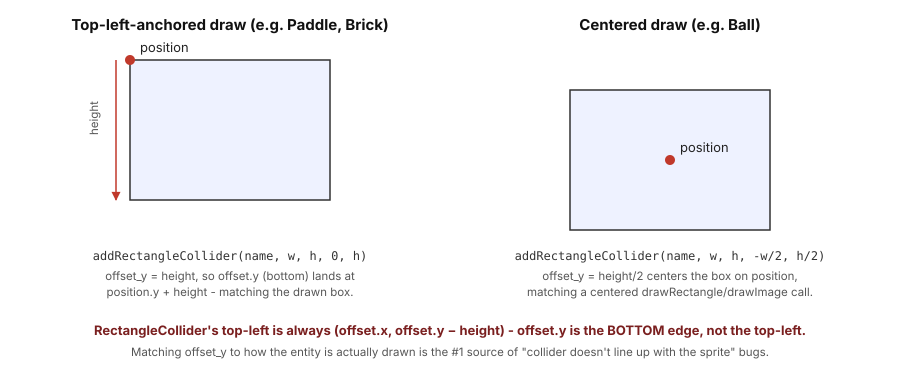
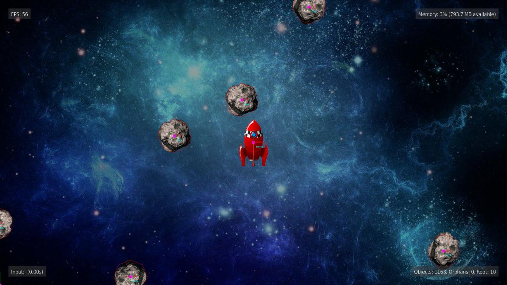
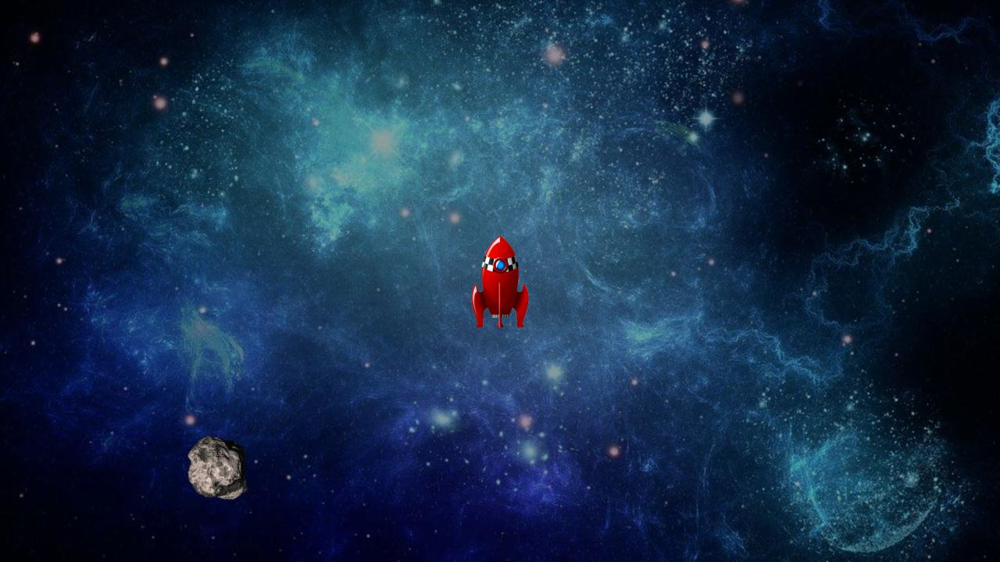
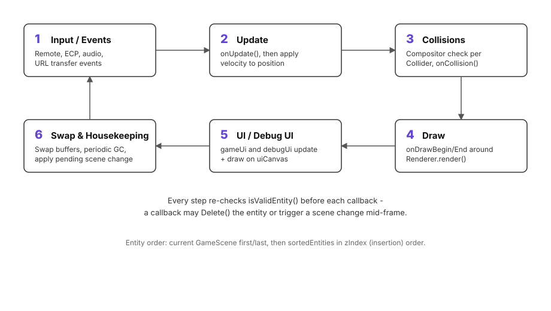

# Building a Game with BrighterScript Game Engine

This guide is for developers building a game *with* BGE - it walks through the pieces you'll
actually touch (`Game`, `GameScene`, `GameEntity`, `Drawable`, `Collider`) and how to put them together:
setting up a game, adding a sprite, moving it, and detecting collisions. For a deeper look at how
the engine implements these pieces internally, see [Engine Internals](/engine-internals).

## What you're building on top of

BGE is an object-oriented 2D-first game engine for Roku channels, written in
[BrighterScript](https://github.com/rokucommunity/brighterscript) and distributed via
[ROPM](https://ropm.dev). Everything lives under the `BGE` namespace. The `examples/` folder in
the repo has around 30 full sample channels, and they're the fastest way to see any of this in action.
Newer ones include `thirdPerson` (an orbit camera and lock-on combat), `flightSim`, `fighter`,
`navigation` and `visualnovel`; the [examples table in the README](https://github.com/markwpearce/brighterscript-game-engine#examples)
lists them all. `quickstart` in particular is a minimal scaffold worth copying as a starting point
for a new game.

## Architecture at a glance


| Piece | What it is |
| --- | --- |
| `Game` | The top-level engine object - one per app. Owns the main loop (`Play()`), the current `GameScene`, every other `GameEntity`, both canvases, and the asset registries (`Bitmaps`, `Sounds`, `Fonts`, `Models`, `Scenes`, `Interfaces`, `Statics`). |
| `GameScene` | A `GameEntity` subclass that represents one state of your game - a title screen, a menu, a level. Only one is current at a time; switching scenes via `Game.changeScene()` destroys non-`persistent` entities. A scene can load its assets over several frames in `onLoad()`, before `onCreate()` runs (see [Loading Assets](/loading-assets)). Its `onPostUpdate()` runs once a frame after every entity has moved, for work that shouldn't depend on update order (pushing characters apart with `BGE.separateCircles()`, a follow camera). |
| `GameEntity` | The base class for anything in your game world - a player, an enemy, a bullet. Exposes lifecycle hooks (`onCreate`, `onUpdate`, `onCollision`, `onDrawBegin`/`onDrawEnd`, `onInput`, …) meant to be overridden, plus `position`/`velocity`/`rotation`/`scale`. |
| `Drawable` | **The recommended way to put anything on screen** - see below. A visual attachment on a `GameEntity` (`Image`, `Sprite`, `AnimatedImage`, `DrawableRectangle`, `DrawableLine`, `DrawablePolygon`, `DrawableText`, `Model3d`) that moves/rotates/scales with the entity automatically. |
| `Collider` | A `CircleCollider` or `RectangleCollider` attached to a `GameEntity`, wrapping a `roCompositor`/`roSprite` region. Collision checks run through the compositor, not manual math. 3D games can use `SphereCollider3d` and `BoxCollider3d` instead. |
| `Renderer` | Wraps an `ifDraw2D` surface (a `Canvas`'s bitmap). Owns the `SceneObject`s it draws each frame and a `Camera`. There's one for the game canvas and a separate one for the UI canvas. |
| `Canvas` | Pairs a bitmap with a `Renderer` and scale/offset. `Game` composites the game canvas and UI canvas to the physical `roScreen` independently each frame, so UI can stay crisp regardless of game-canvas scaling. |
| `UiContainer` / `UiWidget` | A small retained-mode widget tree (`Label`, `Slider`, `Style`, `Alignment`) drawn to its own canvas layer above the game world. `Game.gameUi` and `Game.debugUi` are the two top-level containers. |

> **Three different "scenes."** `BGE.GameScene` is the current state of your game (a title screen, a menu, a level) and is what this guide means by "scene." The renderer's `SceneObject`s are the individual things it draws each frame, one or more per `Drawable`. Roku's SceneGraph `GameScene` node is unrelated to both; it only matters if you mix the engine into a SceneGraph app (see [SceneGraph Shapes](/scenegraph-shapes)).

**Always draw through a `Drawable`, not by calling `Renderer.Draw*()` yourself.**
`examples/asteroids` is worth reading end to end as a reference for doing this consistently -
every entity (`Player`, `Rock`, `Bullet`) is built entirely from `addImage()` +
`addCircleCollider()` in `onCreate`, with no direct `Renderer` calls anywhere in gameplay code.
Beyond being less code, it's what keeps a `Drawable`'s visual position and its `Collider`'s
collision position guaranteed to agree - see
[why that guarantee exists](/engine-internals#colliders-never-go-through-the-camera) if
you're curious about the mechanism.

## Setting up a game

Every BGE app follows the same shape: create a `Game`, define at least one `GameScene`, switch to it,
then start the main loop.

```
sub Main()
  game = new BGE.Game(1280, 720) ' canvas size
  game.fitCanvasToScreen()
  game.loadBitmap("player", "pkg:/sprites/player.png")

  firstScene = new MainScene(game)
  game.defineScene(firstScene)
  game.changeScene(firstScene.name)

  game.play() ' runs until Game.End() is called
end sub
```

`play()` first shows the engine's splash screen for about three seconds while your first scene
loads. See [Splash Screen](/splash-screen) to restyle it, add your own logos or turn it off.

`GameScene` is just a `GameEntity` subclass - a natural place to spawn your initial entities in
`onCreate` and to route global input (pause, quit) in `onInput`:

```
class MainScene extends BGE.GameScene
  sub new(game as BGE.Game)
    super(game)
    m.name = "MainScene"
  end sub

  override sub onCreate(args as roAssociativeArray)
    m.game.addEntity(new Player(m.game))
  end sub

  override sub onInput(input as BGE.GameInput)
    if input.isButton("back")
      m.game.End()
    end if
  end sub
end class
```

If a scene has a lot to load - big models, large images, a level built from thousands of
pieces - load it in `onLoad(loader, args)` instead of `onCreate`. The engine spreads that work
over several frames behind a loading screen, then calls `onCreate` once it's done:

```
override sub onLoad(loader as BGE.AssetLoader, args as roAssociativeArray)
  loader.load3dModel("ship", "pkg:/models/ship.obj")
  loader.loadBitmap("sky", "pkg:/images/sky.png")
end sub
```

See [Loading Assets](/loading-assets) for custom loading work, loading screens and background
loading.

### Changing scenes

Switch scenes by name, passing whatever the next scene's `onLoad`/`onCreate` needs in `args`:

```
m.game.changeScene("LevelScene", {level: 2})
m.game.changeSceneWithFade("TownScene", {from: "crypt"})
m.game.resetScene() ' the current scene again, with the same args
```

The old scene gets `onChangeScene()` then `onDestroy()`, its non-`persistent` entities, `addUi()`
widgets, its own drawables and the lights it added with `addLight()` are removed, and the new
scene's `onLoad()`/`onCreate()` run. Assets it loaded with `loadSceneBitmap()` and friends are
freed then too, unless the new scene asks for them (see
[Loading Assets](/loading-assets#assets-a-scene-owns)). Anything added to the game directly
(`game.addLight()`, `loader.loadBitmap()`, `game.gameUi.addChild()`) stays.
Changing to the scene you're already in (the next level of a level scene, or `resetScene()`)
works exactly the same way, so `onCreate()` can always add its drawables from scratch. Set
`persistDrawablesAcrossSceneChange = true` on a scene to keep its own drawables, or override
`onChangeScene()` (without calling `super`) to clean up yourself.

`game.getSceneNames()` lists the scenes in the order you defined them.

### Exits and spawn points

A scene that the player walks out of, into another scene, can keep its ways out in a
`BGE.SceneExits` and the places it starts the player in a `BGE.SpawnPoints`. Both are optional
helpers the scene owns. Scenes are reused, so make new ones (or `clear()` them) in `onCreate()`:

```
override sub onCreate(args as roAssociativeArray)
  ' Where to start, by the `spawn` arg the last scene's exit passed
  spawns = new BGE.SpawnPoints()
  spawns.add("start", BGE.Math.VectorOps.create(0, 0, 0))
  spawns.add("gate", BGE.Math.VectorOps.create(0, 0, 400), BGE.Math.PI)
  spawn = spawns.resolve(args, "start")
  m.player.position.x = spawn.position.x
  m.player.position.z = spawn.position.z
  m.player.rotation.y = spawn.heading

  ' Ways out, and the args each passes on
  m.exits = new BGE.SceneExits(m.game)
  m.exits.add(new BGE.RectExitArea(-64, 420, 128, 40), "TownScene", {spawn: "gate"})
  m.exits.add(new BGE.CircleExitArea(m.chapelDoor, 40), "ChapelScene")
end sub

override sub onPostUpdate(dt as float)
  m.exits.update(m.player.position)
end sub
```

`resolve()` picks the spawn the args name, else the default you pass, else the first one added.
Pass `new BGE.SpawnPoints("from")` to read another arg. Each spawn has a `heading`; for
something else, like a 2D sprite's four-way facing, subclass `BGE.SpawnPoint` and add it with
`addPoint()`.

`update()` takes the first exit whose area the position is in, fading to its scene
(`fadeSeconds`, 0 for a straight change). A scene is only left once: after that, `hasLeft()` is
true and nothing more is taken, so standing in a doorway while the screen fades doesn't ask
again. If the change is refused because another transition is running, the exit isn't used up
and the next `update()` tries again (an exit to a scene that doesn't exist is disabled instead). `trigger(exit)` takes an exit straight away, e.g. from a
collider's `onCollisionEnter()`.

Areas work on the ground (`BGE.SeparationPlane.xz`, the default) or in 2D (`xy`):
`BGE.RectExitArea`, `BGE.CircleExitArea` and `BGE.GridCellsExitArea` (a block of tile map
cells). To change how exits work:

- Another shape: subclass `BGE.ExitArea` and override `contains()`.
- Another condition, e.g. a locked door or one that needs OK pressed: subclass `BGE.SceneExit`,
  override `isTriggeredBy()`, and add it with `addExit()`. Or set an exit's `enabled`.
- Another transition, or something on leaving (a door sound): subclass `BGE.SceneExits` and
  override `changeSceneFor()` or `onLeave()`.

`examples/rpg` (`DoorExits`, `AreaSpawn`) and `examples/thirdPerson` use both.

### Demo apps: stepping through scenes

For an app that shows one thing per scene, add a `BGE.SceneCycler`: Fast Forward/Rewind change
to the next/previous scene in definition order, Back quits, and a hint is drawn along the bottom
of the screen. It's persistent, so add it once:

```
game.defineScene(new FirstScene(game))
game.defineScene(new SecondScene(game))
cycler = new BGE.SceneCycler(game, {caption: "Next: >>  |  Previous: <<"})
game.addEntity(cycler)
game.changeScene(game.getSceneNames()[0])
```

Options set the buttons (`nextButton`, `previousButton`, `quitOnBack`), the scenes and their
order (`sceneNames`) and the hint (`caption`, `""` for none). Subclass it to do something on
every change - `examples/3d` puts the camera back in `onSceneChanged()` - or override
`changeToScene()` to fade. Set `enabled = false` while a scene needs those buttons itself.
`BGE.cycleDrawMode(entity)` and `BGE.nextDrawMode(mode, first, last)` step through the draw
modes for demos that show them off.

### Laying out UI

UI widgets in `game.gameUi` draw on their own canvas, `game.uiCanvas`, not the game canvas. Unless
you pass `uiWidth`/`uiHeight` to `new BGE.Game()`, `uiCanvas` is the size of the screen (e.g.
1920x1080 on an FHD TV), so UI text stays sharp whatever size the game canvas is. Size and place
widgets from `game.uiCanvas`, not `game.canvas`, or they drift on screens that aren't the game
canvas's size:

```
width = m.game.uiCanvas.getWidth()
height = m.game.uiCanvas.getHeight()
label.customPosition = true
label.customX = width * 0.1 ' title-safe: at least 10% in from every edge
label.customY = height * 0.1
```

A custom-positioned `Label` lines its text up on `customX` by `horizAlign`, like
`Renderer.drawText()`: `"center"` centres it there and `"right"` ends it there, so a score can
sit centred on a point without measuring it:

```
score.horizAlign = "center"
score.customX = width / 2
score.setText(m.score.toStr())
```

To lay out UI in fixed pixels instead, pass a UI size: `new BGE.Game(1280, 720, 1280, 720)` scales
a 1280x720 `uiCanvas` up to the screen.

## Adding a sprite to an entity

A `GameEntity` doesn't draw anything on its own - you attach a `Drawable` to it, almost always from
`onCreate`. `addImage()` is the common case: load a bitmap once (`Game.loadBitmap`), wrap it in an
`roRegion`, and hand that to `addImage()`.

```
class Player extends BGE.GameEntity
  width = 0
  height = 0

  sub new(game as BGE.Game)
    super(game)
    m.name = "Player"
  end sub

  override sub onCreate(args as roAssociativeArray)
    bitmap = m.game.getBitmap("player")
    m.width = bitmap.GetWidth()
    m.height = bitmap.GetHeight()

    ' SetPreTranslation centers the image on m.position instead of drawing
    ' from its top-left corner - the usual choice for a player/enemy/bullet
    region = CreateObject("roRegion", bitmap, 0, 0, m.width, m.height)
    region.SetPreTranslation(-m.width / 2, -m.height / 2)
    m.addImage("sprite", region)
  end sub
end class
```

A few other `Drawable` types for common cases, all added the same way (`m.addWhatever(name, ...)`
in `onCreate`):

- `addSprite(name, spriteSheet, cellWidth, cellHeight)` - a `Sprite` for a single frame cut out of
  a larger sprite sheet. Pass an array of sheets (same cell size) when the frames don't fit in one
  bitmap: cells are numbered across them in order, sheet 0's first.
- `addAnimatedImage(name, regions)` - cycles through an array of `roRegion`s for a walk/idle/attack
  animation; see `examples/pixels`.
- `addDrawableRectangle`/`addDrawableLine`/`addDrawablePolygon`/`addDrawableText` - simple vector
  shapes and text, useful for placeholder art or UI-adjacent visuals in the game world.

## Moving an entity

Every `GameEntity` has a `position` and a `velocity` (both `BGE.Math.Vector`s). Set `velocity` from
`onInput` (or `onUpdate`, for AI/scripted movement) and the engine applies it to `position`
automatically every frame - you don't move entities by hand.

```
override sub onInput(input as BGE.GameInput)
  ' input.x/input.y are -1/0/1 depending on which direction is held
  m.velocity.x = input.x * 300
  m.velocity.y = input.y * 300
end sub
```

`velocity` is in **units per second** (not "units per frame" - a value in the hundreds, like above,
is completely normal). For movement that isn't a direct response to input - drifting, easing
toward a target, gravity - do the math in `onUpdate(deltaTime)` instead, using `deltaTime` (seconds
since last frame) the same way:

```
override sub onUpdate(deltaTime as float)
  m.velocity.y += m.gravity * deltaTime
end sub
```

`rotation` and `scale` work the same way as plain fields you set directly (there's no
"rotational velocity" convenience - update `rotation` yourself in `onUpdate` if you want continuous
spin).

### Keeping things on screen

`BGE.Math` has three helpers for a body inside a `BGE.Math.Rectangle`. They change `position` in
place, and `bounceInRect` changes `velocity` too:

```
' A ball that bounces off the walls and ceiling but can fall out of the bottom
playArea = new BGE.Math.Rectangle(0, 0, m.game.canvas.getWidth(), m.game.canvas.getHeight())
edge = BGE.Math.bounceInRect(m.position, m.velocity, playArea, radius, radius, [BGE.Math.RectEdge.bottom])
if edge <> BGE.Math.RectEdge.none
  m.game.playSound("bounce")
end if

' A player who can't leave the screen
BGE.Math.clampToRect(m.position, playArea, radius, radius)

' A rock that flies off one side and comes back on the other
BGE.Math.wrapInRect(m.position, playArea)
```

The edges are named for world space, where +y is up: `bottom` is the rectangle's `y` and `top`
is `y + height`. `bounceInRect` returns the edge it bounced off, and only flips the velocity of a
body heading out, so a ball resting on an edge doesn't buzz. See `examples/pong` (open ends),
`examples/breakout` (open bottom), `examples/hybrid` (clamp) and `examples/asteroids` (wrap).

### Long frames

A slow frame (the first one on a device can take ~0.4s) makes `deltaTime` big, and a falling
body can move clean through the ground in one step. Set `game.maxDeltaTime` to cap it:

```
game = new BGE.Game(640, 360)
game.maxDeltaTime = 1 / 30.0
```

A slower frame then counts as `1 / 30` of a second everywhere update code sees it: `onUpdate`,
velocity and `getDeltaTime()` (tweens run on wall-clock time, so they aren't capped). The game runs slower than real time while frames are that
slow, so pick a cap above your normal frame time. It's off (0) by default.

### Random numbers

`BGE.Math.randomFloat(min, max)` gives a float from `min` up to `max`, `BGE.Math.randomSign()` gives
1 or -1, and `BGE.Math.RandomInRange(low, high)` gives an integer from `low` to `high`.

For scenery that should land in the same place every time, `BGE.Math.hash2(x, y, salt)` gives a
repeatable number in [0, 1) for a grid cell. Use a different `salt` for each thing you pick:

```
x = cellCenter.x + (BGE.Math.hash2(col, row, 1) - 0.5) * jitter
tree = trees[Int(BGE.Math.hash2(col, row, 2) * trees.Count())]
```

## Tweens

For movement that isn't velocity-driven - a UI panel sliding in, a paddle easing into position,
anything that animates from A to B over a fixed duration - `Game.tweenManager` ticks every live
tween once per frame and writes the interpolated value straight onto whatever field(s) you target,
so there's no manual per-frame bookkeeping:

```
override sub onCreate(args as roAssociativeArray)
  ' ...set up position/Drawable as above, then...
  m.game.tweenManager.to(m.position, {x: 100, y: 50}, 1000, BGE.Tweens.Easing.QuadraticEaseInOut, {
    owner: m
  })
end sub
```

`target` is the object to write onto directly - `m.position` above, or a `Drawable`, or a plain
associative array - not the owning entity itself, and not a dot-path string. Passing `owner: m` (a
`GameEntity`) lets the manager clean the tween up automatically once that entity is no longer
valid, including when a scene change destroys it; without an owner, hang onto the returned handle
and call `game.tweenManager.cancel(handle)` yourself when you're done with it.

For a packed color field (`0xRRGGBB`/`0xRRGGBBAA`), use `toColorRGB()`/`toColorRGBA()` instead of
`to()` - lerping the packed integer directly gives the wrong color, since each channel needs to be
interpolated separately and repacked:

```
m.game.tweenManager.toColorRGB(myDrawable, "color", BGE.ColorsRGB.Red, 500)
```

`options` also accepts `onComplete` (a `sub(target as object)` called once, with the tween's
target, when it retires), `loop` (`BGE.Tweens.TweenLoopMode.restart`/`.pingPong`, default `.none`),
and `delay` (milliseconds before the tween starts).

## Colliders and collisions

Attach a collider the same way you attach a `Drawable` - `addCircleCollider`/
`addRectangleCollider` in `onCreate` - then override `onCollision` to react when it hits another
entity's collider:

```
override sub onCreate(args as roAssociativeArray)
  ' ...set up the Drawable as above, then...
  m.addCircleCollider("body", m.width / 2)
end sub

override sub onCollision(myCollider as BGE.Collider, otherCollider as BGE.Collider, otherEntity as BGE.GameEntity)
  if otherEntity.name = "Rock"
    m.game.destroyEntity(m)
  end if
end sub
```

`onCollision` fires every frame the two colliders overlap. For a one-shot reaction - a door, a
pickup, a trigger zone - override `onCollisionEnter` instead, which fires once when an overlap
starts. `onCollisionExit` fires once when it ends, including when the other entity is destroyed
(its `otherEntity`/`otherCollider` are then `invalid`):

```
override sub onCollisionEnter(myCollider as BGE.Collider, otherCollider as BGE.Collider, otherEntity as BGE.GameEntity)
  if otherEntity.name = "Player"
    m.game.changeSceneWithFade("CastleScene")
  end if
end sub
```

For a circle collider centered on the entity (the common case, matching a centered `Drawable` like
the `Player` example above), the radius is all you need. `RectangleCollider` takes an `offset_x`/
`offset_y` too, and getting that offset right depends on how the entity is drawn:



`addRectangleCollider(name, width, height, offset_x, offset_y)` places the rectangle's **top-left**
corner at `(offset_x, offset_y - height)` - so `offset_y` is the *bottom* edge, one full `height`
below the top-left, not the top-left itself. In practice:

- **Top-left-anchored** (drawn at `position`, growing down/right - a `Paddle` or a `Brick`): use
  `offset_y = height`.
- **Centered** (drawn with `SetPreTranslation`, like the `Player` above): use
  `offset_y = height / 2`.

If a collider ever looks like it's registering at the wrong spot, `Game.debugDrawColliders(true)`
draws every collider's actual bounds and name directly on screen - almost always faster than
guessing from the offset math. Add `Game.debugDrawEntityDetails(true)` to also label each entity
with its name and mark its position:



Compare that to the same scene with debug drawing off:



For 3D games, `addSphereCollider3d()` and `addBoxCollider3d()` do the same job with true 3D overlap,
and `game.raycast()` casts a ray through either kind. See [3D Colliders and Raycasts](/colliders-3d).

Everything above is *detection* - `onCollision` fires, but nothing stops two colliders from
overlapping on screen. `examples/platformer` is the first example that also *resolves* what it
detects: depenetrating the player out of solid ground/walls, tracking a grounded state so jumping
only works while standing on something, and treating one-way platforms as solid from above but
passable from below. None of that lives in the engine - it's ordinary `onCollision` logic built on
top of the same detection-only colliders described above. Read `Player.onCollision` in
`examples/platformer/src/source/Entities/Player.bs` for the concrete pattern.

One thing to know when resolving: colliders that only touch edge to edge don't overlap, so they
don't collide. Once you've snapped the player flush onto the ground, `onCollision` won't fire for
it next frame unless something moves the player back into it. A "grounded" flag that you clear
every frame and expect `onCollision` to set again will flicker. Keep applying gravity while
grounded, or check for ground directly, as the platformer's `Player` does.

### Tags

Every entity and collider has a `tagsList` (`BGE.TagList`) for marking what it is, so
`onCollision` can ask instead of checking class names. Tags are case-insensitive:

```
' In onCreate():
m.tagsList.add("enemy")

' In the player's onCollision(collider, otherCollider, otherEntity):
if otherEntity.tagsList.contains("enemy")
  m.hurt(1)
end if
```

`remove(tag)`, `clear()` and `count()` do what they say. `m.game.getEntitiesByTag("enemy")`
returns every valid entity with that tag.

### Walls in a top-down game

For top-down movement against static walls, `BGE.SolidWorld` does the resolving for you. Add
the solid rectangles once when the scene is built, then move each walker's feet box through them
instead of setting its `velocity`. It stops the box flush against walls, slides it along them,
and eases it around corners it only just clips:

```
' In the scene's onCreate:
m.solidWorld = new BGE.SolidWorld()
m.solidWorld.addBounds(0, 0, mapWidth, mapHeight)
m.solidWorld.addSolid(wallX, wallY, wallWidth, wallHeight)

' In the player's onUpdate (the feet box is 20x12, its bottom-centre at the entity's position):
feetBox = {x: m.position.x - 10, y: m.position.y, w: 20, h: 12}
result = m.solidWorld.moveAndSlide(feetBox, moveX * speed * dt, moveY * speed * dt)
m.position.x = result.x + 10
m.position.y = result.y
```

Rectangles are `{x, y, w, h}` with `(x, y)` the bottom-left corner. Pass `{cornerNudge: 0}` as a
fourth argument for moves that shouldn't be eased around corners, like a knockback.
`examples/rpg`'s `Player` and `Rat` both move this way.

`addSolid` returns an id. Pass it to `removeSolid(id)` to take that rectangle back out, for
example when a door opens.

When knockback and `BGE.separateCircles()` also move a body, track it with
`m.solidWorld.track(entity, radius)` and call `m.solidWorld.resolveTracked()` once everything has
moved, e.g. in `onPostUpdate()`. Setting the scene's `trackedSolidWorld` makes the game do that for
you after `onPostUpdate()`. See [Tile maps](/tile-maps#tracking-bodies).

### Hit flash and knockback

A hit usually tints the sprite for a moment and shoves the entity away from the attacker.
`Drawable.flash()` does the tint, and a `BGE.Impulse` does the shove:

```
import "pkg:/source/utils/Impulse.bs"

class Enemy extends BGE.GameEntity
  sprite as BGE.Sprite
  knockback as BGE.Impulse = new BGE.Impulse()

  sub hurt(attacker as BGE.GameEntity)
    m.sprite.flash(&hFF5050, 0.15)
    away = BGE.Math.VectorOps.getNormalizedCopy(BGE.Math.VectorOps.subtract(m.position, attacker.position))
    ' 400 units/s away, losing 10x its speed per second
    m.knockback.start(BGE.Math.VectorOps.scale(away, 400), 10)
  end sub

  override sub onUpdate(dt as float)
    push = m.knockback.step(dt)
    m.position.x += push.x
    m.position.y += push.y
  end sub
end class
```

The flash color is RGB, like `Drawable.color`. The flash never changes `color` itself, so your
code can keep setting `color` (a tint that follows the enemy's state, say) and the drawable goes
back to whatever it is when the flash ends. Flashing again restarts it, `stopFlash()` ends it,
and a third argument makes it blink: `flash(&hFF4040, 0.6, 0.08)` alternates every 0.08 seconds.
A fourth fades it too (`flash(&hFF4040, 0.6, 0.08, 128)`), and `flashAlpha(60, 1.0, 0.1)` only
fades it, keeping its color - an invulnerability flicker. `alpha`, like `color`, is never
changed. The game ticks flashes for you, just before the entity's `onUpdate()`, and holds them
while paused.

`step(dt)` returns how far to move this frame rather than moving anything, so you can send it
through your own collision instead, e.g. `m.solidWorld.moveAndSlide(feetBox, push.x, push.y,
{cornerNudge: 0})`. `startTimed(displacement, seconds)` moves at a constant speed for a fixed
time instead of easing out, and `isActive()` says whether a push is still running, for skipping
the entity's own movement meanwhile. A fixed-tick game can call `step(1)` each tick and give
speeds and the decay rate per tick. `examples/rpg`'s `Enemy` and `examples/thirdPerson`'s
`Fighter` use both.

## Following the player with the camera

The default camera is a `BGE.Camera2d` centred on `camera.setTarget(point)`. For a world bigger
than the screen, let it follow an entity and keep it inside the level:

```
camera = m.game.canvas.renderer.camera as BGE.Camera2d
camera.setBounds(0, 0, levelWidth, levelHeight)
camera.follow(playerEntity)
```

`follow()` re-centres on the entity every frame after every `onUpdate` has run, so the view is
never a frame behind. `setBounds()` stops the view showing past the level's edges (and centres a
level that's smaller than the screen); it also applies to plain `setTarget()` calls.

For a 3D game, see [Third-Person Cameras](/third-person-cameras) for an orbit camera that follows
the player, lock-on, and chase cameras for vehicles.

### Zooming

Every camera has a `zoom`: 1 is the normal view, 2 draws the area round the middle of the view
twice as big, 0.5 half as big. Set it directly, or ease it:

```
camera.zoomTo(2, 0.5) ' to 2x over half a second
camera.zoomTo(1, 0.5, BGE.Tweens.Easing.QuadraticEaseOut)
```

`zoomTo()` runs on the camera's own clock, so it works without a `Game` too. It eases the zoom's
logarithm, so going from 1 to 4 looks even all the way rather than rushing through 1 to 2.
`isZooming()` says whether it's still going, and `stopZooming()`, or setting `zoom` yourself,
stops it.

With a `Camera2d` the world is scaled about the middle of the canvas: images, text, rectangles,
circles, particles and parallax layers all draw `zoom` times as big, `follow()` keeps the entity
in the middle, and `setBounds()` clamps against the smaller view (`frameSize / zoom` world units),
so a zoomed-in camera can get nearer the level's edges. Line and outline widths stay in pixels.
Edge-to-edge tiles still meet exactly at a fractional zoom (part way through a `zoomTo()`). The
UI canvas has its own camera and isn't zoomed.

With a `Camera3d`, zoom multiplies the focal length, which narrows the field of view
(`getEffectiveFieldOfViewDegrees()`) - see [Third-Person Cameras](/third-person-cameras#zooming).

`examples/rpg` zooms in and out on Replay.

## Melee combat helpers

A few small pieces cover what most melee games redo by hand. `examples/thirdPerson` uses all
three.

**Did the swing land?** `BGE.Math.isWithinArc()` tests a ground-plane wedge (heights ignored,
heading 0 faces -z), the same shape `Renderer.drawWorldArc()` draws for debugging. The optional
last argument is the target's body radius, added to the reach:

```
if BGE.Math.isWithinArc(m.position, m.rotation.y, foe.position, swingReach, swingHalfAngle, foe.bodyRadius)
  foe.takeHit(damage)
end if

' Debug view of the same swing
renderer.drawWorldArc(m.position, swingReach, m.rotation.y - swingHalfAngle, m.rotation.y + swingHalfAngle, BGE.Colors.Red, true)
```

**Who may attack?** `BGE.TokenPool` is the "attack token" pattern: at most `maxHolders` ids hold a
token, and after a release nobody can take one for `cooldownSeconds`, so enemies take turns rather
than piling in. Ids are strings or integers (`GameEntity.id` works), never the objects themselves:

```
m.attackTokens = new BGE.TokenPool(1, 1.2) ' one attacker, 1.2s between attacks
m.attackTokens.update(dt)                  ' once per frame

' In an enemy:
if inRange and m.attackTokens.request(m.id)
  m.startAttack()
end if
m.attackTokens.release(m.id)               ' when the attack ends, or it dies
```

`idleSeconds()` is how long nobody has held a token, e.g. to let an enemy out of view attack
once the player has had a long enough break.

**Health bars.** `Renderer.drawWorldBar()` draws a screen-aligned bar with its bottom-centre on a
world point, in RGBA colours like the other `Renderer.draw*` calls. The fraction is clamped to
0..1, the fill is inset by a border (1px by default) of the background colour, and nothing is
drawn when the point is behind the camera:

```
override sub onDrawEnd(gameRenderer as BGE.Renderer, uiRenderer as BGE.Renderer)
  head = BGE.Math.VectorOps.create(m.position.x, m.height, m.position.z)
  gameRenderer.drawWorldBar(head, 42, 6, m.health.fraction(), &hD03030FF, &h000000C0)
end sub
```

The size is in canvas pixels, so the bar stays the same size at any distance.
`examples/rendererTest`'s `combat-helpers` demo shows the bars and the arc test together.

## Health, stamina, state timers and respawning

Four small classes cover state that most action games keep per entity. None of them is
required, and none registers itself: the entity (or scene) owns one and calls its `update(dt)`
from `onUpdate()`. Each has hooks you can override in a subclass.

**Health.** `BGE.Health` holds `current` and `max`. `damage()` returns true when the hit killed,
and ignores hits while dead or while invulnerable:

```
import "pkg:/source/utils/Health.bs"

class Bandit extends BGE.GameEntity
  health as BGE.Health = new BGE.Health(3)

  sub hurt(amount as float)
    if m.health.damage(amount)
      m.die()
    else
      m.sprite.flash(&hFF5050, 0.15)
    end if
  end sub
end class
```

Set `invulnerableSeconds` to ignore hits for a while after each one (call `update(dt)` each
frame so it runs out), or call `makeInvulnerable(seconds)` yourself, e.g. on respawn.
`canTakeDamage()` asks before you play a hit sound, `invulnerableRemaining()` can drive a blink,
and `fraction()` feeds a health bar. `heal()` stops at `max` and doesn't revive; `refill()` does,
and `reset(max)` sets a new max and refills. Override `onDamaged(amount)` and `onDeath()` in a
subclass to react there instead.

**Stamina, mana, ammo.** `BGE.RegenPool` is a resource that actions spend and that refills after a
pause:

```
import "pkg:/source/utils/RegenPool.bs"

m.stamina = new BGE.RegenPool(100)  ' starts full
m.stamina.regenPerSecond = 50
m.stamina.regenDelaySeconds = 0.6   ' after the last spend

' In onUpdate(dt):
if dodgePressed and m.stamina.spend(28)
  m.startDodge()
end if
m.stamina.update(dt, m.isBlocking)  ' true: regenerate at slowedRegenFactor (0.35) of the rate
```

By default any amount left is enough, and the pool stops at zero. That's souls-style stamina;
set `requireFullAmount = true` when an action needs its whole cost, like mana or ammo. A refused
`spend()` returns false and makes `isDenied()` true for `deniedSeconds` (0.4), for the HUD to
flash the bar (`deniedRemaining()` jumps back up on each refusal). `drain(amount)` always takes
it, for costs you can't refuse such as a blocked hit, and returns false if the pool ran dry.
`refill()` and `fraction()` work like `Health`'s.

**States.** `BGE.StateClock` keeps a state name and the seconds spent in it. Call `update(dt)` at
the top of `onUpdate()`, then branch on `state`:

```
import "pkg:/source/utils/StateClock.bs"

m.clock = new BGE.StateClock("walk")

' In onUpdate(dt):
m.clock.update(dt)
if m.clock.state = "walk" and m.isNearPlayer()
  m.clock.setTimed("tell", 0.4)
else if m.clock.state = "tell" and m.clock.isTimeUp()
  m.clock.setTimed("lunge", 0.25)
else if m.clock.state = "lunge"
  if m.clock.justEntered()
    m.game.playSound("swing")
  end if
  if m.clock.isTimeUp()
    m.clock.set("walk")
  end if
end if
```

`set(state)` enters an open-ended state and does nothing if it's already the current one, so
it's safe to call every frame; `set(state, true)` re-enters it. `setTimed(state, seconds)` always
(re-)enters, and `isTimeUp()`, `remaining()` and `remainingFraction()` (1 falling to 0) follow its
time; the clock never leaves a state by itself. `seconds` counts up in either kind, and
`justEntered()` is true for one update after entering, for one-off entry work. To switch
animations with the state, set `clock.sprite` (or `clock.orientedSprite`) and call
`clock.play(name)`, which only switches when the name changes. Override `onEnter(previousState)`
for anything else.

**Respawning.** `BGE.RespawnTimer` is the wait between a death and coming back. Call `start()`
when the player dies; `update(dt)` returns true on the frame the delay runs out, and what a
respawn means is up to you:

```
import "pkg:/source/utils/RespawnTimer.bs"

m.respawn = new BGE.RespawnTimer(2.0)  ' seconds; 3 by default

' When the player's health runs out:
m.respawn.start()

' In onUpdate(dt):
if m.respawn.update(dt, not m.game.isTransitioning())
  m.game.resetScene()  ' or move the player to a spawn point and refill() their health
end if
```

`start()` does nothing while already waiting, so it's safe to call every frame the player is
dead; `start(true)` starts the delay over, and `cancel()` stops waiting. The second argument to
`update()` holds a due respawn back until it's true, e.g. while a scene transition runs.
`progress()` (0 rising to 1) and `remaining()` can drive a fade or a countdown. Override
`onRespawn()` in a subclass to do the respawn there instead.

`examples/thirdPerson`'s `Knight` uses the first three, and its scenes respawn him with
`RespawnTimer`; the rpg's `Goblin`, `GoblinKing` and `Witch`
and the platformer's `PlantBoss` use `StateClock` and `Health`, and the rpg's `Player` waits out
a defeat with `RespawnTimer`.

**Plain countdowns.** For a cooldown, coyote time or an input buffer, `BGE.CountdownTimer` is
the bare version: `start(seconds)`, `tick(dt)` once a frame, then `isActive()` while time is left.
`remaining()` gives the seconds left and `stop()` ends it early:

```
import "pkg:/source/utils/CountdownTimer.bs"

m.dashCooldown = new BGE.CountdownTimer()

' In onUpdate(dt):
m.dashCooldown.tick(dt)
if dashPressed and not m.dashCooldown.isActive()
  m.startDash()
  m.dashCooldown.start(0.8)
end if
```

## Picking targets

`BGE.Targeting` answers "which enemy is the player looking at?" for lock-on, auto-aim or homing
shots. Its functions take a list of candidates (anything with a `position`, such as entities),
so filter out the dead or friendly ones first:

```
import "pkg:/source/utils/Targeting.bs"

living = []
for each foe in m.enemies
  if foe.isAlive()
    living.push(foe)
  end if
end for
' Within 15 m and 0.4 * PI either side of where the camera looks
target = BGE.Targeting.pickInView(living, m.player.position, m.orbit.heading, 480, BGE.Math.PI * 0.4)
' A flick of the look stick to the right (side 1) or left (-1)
nextTarget = BGE.Targeting.nextByBearing(living, m.player.position, target.position, 1, m.orbit.heading, 480, BGE.Math.PI * 0.4)
```

`pickInView()` picks the nearest candidate in range and view, but counts one straight ahead as
closer: its score is `distance * (1 + angleWeight * angle)`, lowest wins. Pass
`{angleWeight: 0.0}` for plain nearest, or a bigger weight to favour aim over distance.
`nextByBearing()` returns invalid when there's nothing further that way, so a flick at the end of
the row keeps the current target. Both return the candidate itself; cast it back to your class.

Headings follow the engine's convention, 0 facing -z, so a camera's heading goes straight in.
Positions are on the ground (x and z) by default. For a 2D game such as a twin-stick or top-down
shooter, pass `{plane: BGE.SeparationPlane.xy}`: heading 0 then faces -y and PI/2 faces +x.
World +y is up, so heading 0 points down the screen. `BGE.Targeting.bearing()` and
`distance()` measure the same way, e.g. to aim a turret.
`examples/thirdPerson`'s `CombatDirector` uses both for the knight's lock-on.

## The game loop

`Game.Play()` runs one main loop. Every frame goes through six steps, always in this order:



A few things fall out of this that matter in practice:

- **Entity order**: the current `GameScene` is always processed first. In update and collisions
  the other entities (`sortedEntities`) then run newest first; in both draw passes they run in the
  order they were added. Only the scene's `onPostUpdate()` runs after everything else.
- **Callbacks can invalidate their own entity.** A callback might call `invalidate()` on itself
  (or `game.destroyEntity()` on another), or trigger a scene change. That's why the engine re-checks `isValidEntity()` before every single
  callback - if you write code that processes many entities in a loop (rare for game code, common
  for engine-level tooling), follow the same pattern.
- **Scene changes are deferred to end-of-frame.** Calling `Game.changeScene()` mid-frame doesn't
  swap the scene immediately - it's applied after the draw/swap step, once the current frame is
  fully done with the old scene.
- **`Game.changeSceneWithFade(name, args)`** fades to black, changes scene, then fades back in
  after the new scene's `onCreate`. `Game.isTransitioning()` is true for the whole thing, so check
  it before acting on gameplay input. With no current scene yet, it changes scene straight away and
  fades in from black - a handy way to start the first scene.
- **`Game.screenFade`** is the overlay that fade uses, and you can drive it yourself:
  `m.game.screenFade.fadeTo(0.6, 0.25)` dims the screen behind a pause menu over a quarter
  second, and `fadeTo(0, 0.25)` clears it. Opacity runs 0 (clear) to 1; set `screenFade.color`
  (`&hRRGGBB`, black by default) for another colour. It draws on top of the game and the UI.

## Debugging tools worth knowing early

Add the standard debug panels, then bind a button that cycles through debug overlays:

```brighterscript
game.enableStandardDebugUi({memory: false, garbageCollector: false})
' * (options) steps: off, panels, + entity details, + colliders, then back to off
game.enableDebugToggle()
```

Each press of the button applies the next level and wraps back to the first. Pass your own
`levels` to change the cycle; each is a set of flags (`showUi`, `colliders`, `entityDetails`,
`safeZones`, `occlusion`), optional `panels` (rebuilds the panels with
`enableStandardDebugUi(panels)`) and an optional `apply` callback for anything else:

```brighterscript
game.enableDebugToggle({
  button: "replay", ' or action: "debug" to use a bound ControlMap action
  levels: [
    {},
    {showUi: true, panels: {input: false, memory: false, garbageCollector: false, log: false}},
    {showUi: true, panels: {}, colliders: true, apply: sub(game as BGE.Game)
      game.debugDrawSafeZones(true)
    end sub}
  ]
})
```

Nothing is bound unless you call `enableDebugToggle()`. The toggle only touches flags one of its
levels sets (a level leaving out one of those turns it off), so a game can still set the others
itself. `startLevel` says which level the game starts in without applying it - e.g. 1 when
`main.bs` already called `debugShowUi(true)`. The press isn't consumed, so pick a button gameplay
doesn't use, or set `game.debugToggle.enabled = false` while it does. Each change posts a
`"debugLevelChanged"` game event (`{level, previousLevel}`) for example-specific overlays, and a
`BGE.Debug.DebugToggle` subclass (override `applyLevel()` or `onLevelChanged()`) can be assigned
to `game.debugToggle`.

### Perf stats on the console

`debugPrintPerfStats()` prints entity/collider counts and one frame's phase times (UI input,
update+collision, entity draw, buffer swap) every interval. Pass options to also collect every
frame in the interval and print a summary line:

```brighterscript
game.debugPrintPerfStats(true, 3) ' counts and phases every 3 seconds
game.debugPrintPerfStats(true, 3, {stages: true, runId: "baseline"})
```

With options, each interval prints the counts and phases, then a summary line (and
`PERF start baseline` once when it's turned on):

```text
Entities: 73 | Colliders: 23
Phase ms - uiInput: 0 | update+collision: 5 | entityDraw: 19 | swap: 1
PERF fps 29.4 frameMs 34.0 | update 2.1ms x1 | walls 9.8ms x1 | ... | med 33 p90 41 max 67 spikes 3/88 | run baseline
```

`stages: true` turns on the game renderer's `profileStages` and adds each stage's average
milliseconds and runs per frame (`stageNames` picks which, in order). The frame times are the
median, any other `percentiles` (default `[0.5, 0.9]`), the longest frame and how many frames ran
over `spikeFactor` (default 1.5) times the median. `runId` tags each line, so runs are easy to
tell apart in a log. The stage timers cost a timer read per scene object drawn, so compare fps
with `stages` off too.

To show or send the numbers your own way, pass `onStats` (and `printToConsole: false` to print
nothing). It gets a `BGE.Debug.PerfStatsSummary` each interval, with the entity/collider counts
and phase times added:

```brighterscript
game.debugPrintPerfStats(true, 5, {
  printToConsole: false,
  onStats: sub(stats as BGE.Debug.PerfStatsSummary, game as BGE.Game)
    game.log(`fps ${stats.fps} p90 ${stats.percentileMs[1]}ms`)
  end sub
})
```

Nothing is collected until you call it. For a report of your own (extra per-frame numbers, its
own line), keep a `BGE.Debug.PerfStats` yourself: `addFrame(ms, stageMs, stageCounts)` each frame,
then `getSummary()`, `format()` (or `formatStages()`/`formatFrameTimes()` for parts of the line)
and `reset()`. `examples/thirdPerson`'s `PerfLog` does this with `perf=1`, adding object,
occlusion and impostor counts to the line.

### Other debug helpers

- `Game.debugDrawColliders(true)` / `Game.debugDrawEntityDetails(true)` / `Game.debugShowUi(true)`
  set the same flags directly - the collider-outline view above, plus per-entity name/position
  labels.
- `Game.getDebugUI().addChild(new BGE.Debug.FpsDisplay(game))` and
  `BGE.Debug.InputDisplay`/`MemoryDisplay`/`GarbageCollectorDisplay`/`LogDisplay` are ready-made
  debug widgets - most examples wire up at least the FPS display in `main.bs`. `InputDisplay`
  draws a remote or gamepad per player with every held button highlighted and the analog sticks
  shown, so you can check simultaneous input from several controllers at a glance. Set its
  `mode` to `BGE.Debug.InputDisplayMode.text` (or pass `{inputDisplayMode: "text"}` to
  `enableStandardDebugUi()`) for a compact line of text per player instead.
- `Game.log(message, level)` records a message (`BGE.Debug.LogLevel.info`/`warning`/`error`,
  defaulting to `info`) that's both printed and kept in a short history `BGE.Debug.LogDisplay`
  reads from - prefer it over a raw `print` in your own game code so failures are visible
  on-screen, not just over telnet. Code with no `Game` to hand can call
  `BGE.Debug.logMessage(message, level)`, which goes through the most recently created `Game`
  (or is just printed on a thread with none, e.g. a Task). The engine's own warnings and errors
  use it too.
- `examples/rendererTest` is a menu-driven suite of `Renderer` demos built *without* `Game`/`GameScene`
  at all - useful for trying out a specific rendering capability (draw modes, texture columns,
  camera projection) in isolation before wiring it into a real game.

## Where to go next

- Skim `examples/quickstart` for the smallest possible working game.
- Read `examples/asteroids` as the reference for building entities entirely out of
  `Drawable`s/`Collider`s, with no direct `Renderer` calls in gameplay code.
- Read `examples/breakout` or `examples/pong` for a complete, small, real game with comments
  explaining the collider-offset and velocity choices made for each entity.
- Loading lots of assets, or building a big level? See [Loading Assets](/loading-assets) for
  `onLoad()`, loading screens and background loading, and `examples/loading` for a runnable demo.
- Building a level out of tiles? See [Tile Maps](/tile-maps) for baking the ground, tile
  collision for side-scrolling and top-down games, and auto-tiling.
- See [Engine Internals](/engine-internals) for how the renderer, camera, and collision
  system fit together under the hood - useful once you're debugging something that doesn't behave
  like the docs above suggest it should.
