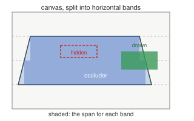

# Occlusion Culling

A big solid thing in a 3D scene hides whatever stands behind it: a building, a wall, a hill.
Occlusion culling lets the renderer skip the things it fully hides, and skip the work of
projecting and drawing them. You opt in one drawable at a time with `isOccluder`. The renderer
does the rest.

This guide covers what to mark, how the renderer decides what is hidden, the draw settings
that trade accuracy for speed, and what it costs. For the drawable side (the `isOccluder` key
on each type, and `getVisibility()`), see
[Drawables and Scene Objects](/drawables-and-scene-objects#occluders-and-visibility). For the
other draw-quality settings, see [Render Quality](/render-quality).

Occlusion only works with a `Camera3d`. Under a `Camera2d` nothing counts as an occluder and
nothing is hidden.

## Marking an occluder

Set `isOccluder: true` on the drawable. The owning entity must also be static, because an
occluder never moves. Here is a static model that hides what's behind it:

```brighterscript
class Tower extends BGE.GameEntity

  override sub onCreate(args as roAssociativeArray)
    m.isStatic = true
    m.position = BGE.Math.VectorOps.create(args.x, 0, args.z)
    m.addDrawable("tower", new BGE.DrawableModel(m, m.game.get3dModel("tower"), {
      isOccluder: true,
      drawMode: BGE.SceneObjectDrawMode.solid
    }))
  end sub

end class
```

An image or a rectangle works the same way, through `m.addImage(name, region, {isOccluder: true})`
or `m.addRectangle(name, width, height, {isOccluder: true})`.

You can switch `isOccluder` on or off at any time. A wall that becomes see-through can turn it
off. If the owner isn't static, the renderer logs a warning once and draws the drawable as
normal. The drawable registers as an occluder as soon as its owner is made static.

Only mark a drawable that is fully opaque. The engine can't check the texture or the model's
colours. Anything behind a see-through occluder will vanish.

## Which drawables can occlude

| Drawable | Occludes | Notes |
| --- | --- | --- |
| Image (`Image`, `AnimatedImage`, `Sprite` via `SceneObjectImage`) | Yes | Only if it has no transparent pixels. The engine can't check that. |
| Rectangle (`DrawableRectangle`) | Yes, when `filled` | An outline-only rectangle draws but hides nothing. |
| Model (`DrawableModel`) | Yes | Only if every face is opaque. The engine can't check that. A static model is merged into convex panels the first time it registers. |
| Freestanding wall (`DrawableWall`) | Yes | It sets `isOccluder` by default. Set `wall.isOccluder = false` where you can see through it. |

Everything else can't occlude: circles, polygons, lines, text, particles, planes and skyboxes
(`DrawablePlane` and `DrawableSkybox` are Images, but they can't occlude). Level walls
(`DrawableWalls`, `DrawableGridWalls`) are a separate system. They hide sorted objects in
their own pass, not through `isOccluder`.

A drawable with `alpha` below 255 doesn't occlude in that frame. It doesn't occlude while it
fades out with distance either, unless fog is filling in behind it (see
[the fog section](/drawables-and-scene-objects#fog)).

## Draw modes

The renderer occludes only with oriented draw modes:

- `solid`, `solidDrawBackFace`
- `oriented`, `orientedDrawBackFace`
- `matchCamera`, which on a `Camera3d` draws as oriented

These are ignored, and the drawable draws normally:

- the screen-aligned modes: `directToCamera`, `directScaled` and `axisAligned`. The renderer
  logs a warning when it turns one down.
- the wireframe modes, with no warning

An image or rectangle occludes only while it faces the camera, unless its mode is
`orientedDrawBackFace`. A model occludes with the faces that face the camera, and in
`solidDrawBackFace` or `orientedDrawBackFace` with the faces turned away too. Use one of those
for an occluder you see from the inside, such as the walls of a room.

## How the span map hides objects

Each frame the renderer does this:

1. It projects every registered occluder to the canvas as convex polygons: one for an image
   or rectangle, one per merged panel for a model. If there are more than `maxOccluders`
   polygons (32 by default), it keeps the largest by screen area.
2. It builds a span map. The canvas is cut into `occlusionBandCount` horizontal bands (45 by
   default). For each band, the map holds the x ranges that some occluder covers across the
   whole band. Each range keeps the farthest depth of the occluders merged into it. That keeps
   the test conservative: an object must be behind all of them.
3. It tests each object that could be hidden. The object's canvas box is grown by
   `occlusionMargin` (2 pixels by default), plus its `outlineWidth` if it has an outline. The
   object is hidden only when, in every band the box touches, one merged range covers the whole
   box, and that range's depth is nearer than the object's nearest point.
4. Hidden objects are skipped in the draw loop. Their `getVisibility()` reports
   `BGE.VisibilityState.occluded`.



The test only ever hides something it can prove is covered. If any point of the object fails
to project, the object is drawn. Anything partly off the canvas is drawn too. Planes, skyboxes,
parallax layers, level walls, voxel terrain and text are never hidden. Occluders are never
hidden either.

## Approximate drawing and the occluder's claim

An occluder draws like any other object, and that includes the cheap paths. While the camera or
the occluder moves, it may reuse a cached bitmap or fill with coarse bands. Its picture is then
slightly off, so the area it claims to cover could include a pixel it doesn't paint.

`renderer.occluderDrawPolicy` picks how that is handled:

- `BGE.OccluderDrawPolicy.fastShrink` (the default). The occluder's claim shrinks by the
  largest error its fast path can make that frame. It rarely hides something it doesn't cover.
  An object right at its edge can stay drawn while the camera moves, and is hidden again once
  the camera stops.
- `BGE.OccluderDrawPolicy.exact`. Occluders always draw exactly and claim their full outline.
  This hides the most, and costs the most to draw.
- `BGE.OccluderDrawPolicy.fastExactClaim`. Occluders keep their fast paths but claim their full
  outline. An object just behind an edge can disappear for a few frames while the camera moves.

```brighterscript
m.game.canvas.renderer.occluderDrawPolicy = BGE.OccluderDrawPolicy.exact
```

A change takes effect on the next frame. The renderer then redraws the cached bitmaps once.

## Settings

These are fields on the `Renderer` (`m.game.canvas.renderer`). They aren't part of the render
quality levels.

| Field | Default | What it does |
| --- | --- | --- |
| `occlusionCullingEnabled` | `true` | Turns the feature off. With no occluders registered it costs nothing either way. |
| `occlusionBandCount` | `45` | Bands across the canvas height. More bands fit the map to the shape better, and cost more to build. |
| `maxOccluders` | `32` | Most occluder polygons used per frame. The largest on screen are kept. |
| `occlusionMargin` | `2.0` | Pixels added around each tested box. |
| `occluderDrawPolicy` | `fastShrink` | See above. |

## Debugging

`game.debugDrawOcclusion(true)` turns on the overlay. It shades the spans the occluders cover
with translucent blue, and draws a red box around every object hidden this frame.
`game.isDebugDrawingOcclusion()` reads the flag back. The debug toggle (`enableDebugToggle()`)
has an `occlusion` flag that does the same.

To see what the feature is doing, read these from the renderer after each frame:

- `getOccludedCountLastFrame()` - objects hidden by occlusion or by walls
- `getOcclusionMsLastFrame()` - how long occlusion took
- `getOcclusionTestsLastFrame()` - objects that needed a full test

To find out whether it pays off in your game, turn `occlusionCullingEnabled` on and off and
compare the frame times. `examples/terrain/src/source/TerrainProfiler.bs` runs the four settings
(off and the three policies) one after another and reports the times.

## What it costs

- **Nothing without occluders.** With no occluders registered, the renderer does one check
  per frame.
- **The map is rebuilt only when it changes.** That happens when the camera moves, an occluder
  is added or removed, an occluder starts or stops counting (its alpha, fade or enabled state),
  its draw path changes how much it claims, the projection or canvas size changes, or an
  occlusion setting changes. A still camera with still occluders reuses the map, and an
  object's verdict stands until the object or the map changes.
- **Building costs more with more occluders and bands.** The work grows with the number of
  bands each occluder covers. `maxOccluders` caps the number used.
- **Moving frames are the expensive ones.** The occluders are projected again, and every
  candidate object is tested again. Compare `getOcclusionTestsLastFrame()` with the frame time.
- **It pays off only when the hidden things are expensive.** Warped textures and models are
  the best case. A cloud of cheap sprites barely breaks even.
- **Models are merged once.** The first time a static model registers, its coplanar,
  edge-sharing triangles are merged into convex panels. That is done once per geometry change.
  A model with many small irregular faces gives many panels, and so costs more. Each panel
  counts toward `maxOccluders`.

The thirdPerson example's town is a case where it doesn't pay. Its open streets hide little,
so occlusion is off there by default (see `examples/thirdPerson/src/source/Scenes/TownScene.bs`).
The renderer's draw costs vary a lot from device to device, so measure on the device you ship
to. The `rendererTest` demos `occlusion-span-map-benchmark`, `occlusion-scene-benchmark` and
`occluder-panels-benchmark` time the parts separately.

## Examples

- `examples/terrain`: `Chapel.bs` is a static model with `isOccluder: true` that hides the trees
  behind it. In `WorldScene`, the OK button toggles occlusion.
- `examples/thirdPerson`: `Entities/PropModel.bs` makes some props occluders, and they also cast
  fog silhouettes. `Entities/Fence.bs` turns occlusion off for the see-through part of a fence.
