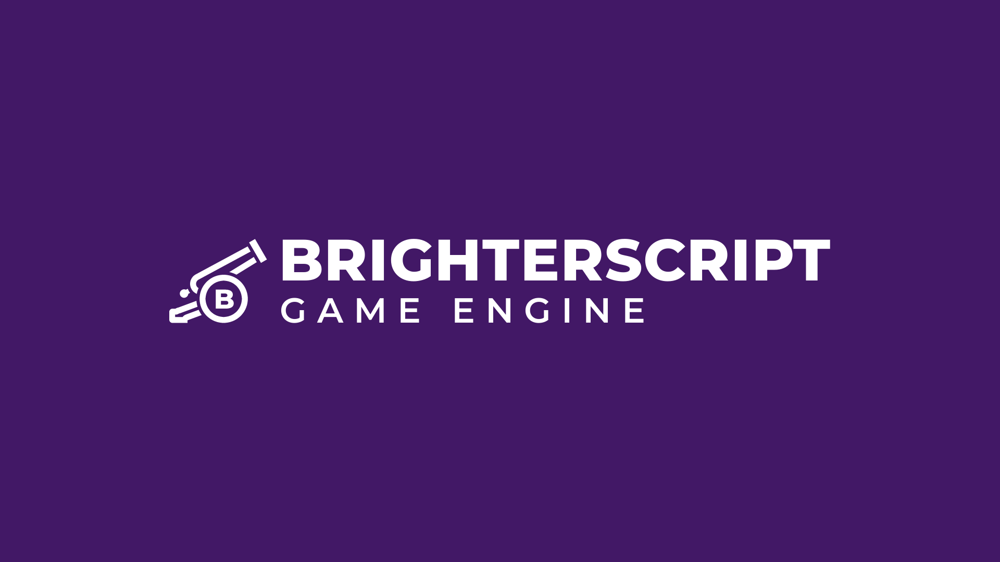

# Splash Screen

When `game.play()` starts, the game shows the BrighterScript Game Engine logo for about three
seconds: a cannon fires a ball beside the title, with a startup sound. Your first scene loads
underneath it, then fades in. You can add your own studio or publisher logos after it. For the
rest of the engine, see the [Game Engine Overview](/game-engine-overview).



The splash is `game.splash`, a `BGE.SplashSequence`. Set it up before calling `play()`.

## Turning it off

```brightscript
game.splash.enabled = false
game.play()
```

Please keep it, or credit the engine somewhere else in your game, such as a credits screen.

## Colours and sound

The engine's card is `game.splash.engineCard`. Pick one of four colour schemes:

```brightscript
game.splash.engineCard.useScheme(BGE.SplashScheme.Dark)
```

| Scheme | Background | Cannon | Title |
| --- | --- | --- | --- |
| `Purple` (default) | purple | white | white |
| `Dark` | near-black | orange | off-white |
| `Cream` | cream | purple | near-black |
| `Teal` | teal | yellow | white |

Or set the colours yourself (packed RGBA), and turn off the sound:

```brightscript
card = game.splash.engineCard
card.backgroundColor = &h000000FF
card.cannonColor = &hFF4040FF
card.titleColor = &hFFFFFFFF
card.sound = false
```

The art comes in two sizes: games with a UI canvas 1080 lines high or more get the 1080p art, and
the rest get the 720p art, scaled to fit. The logo is always centred and plays the same animation.

## Your own logos

Add cards after the engine's. They play in the order you add them, cross-fading from one to the
next. `BGE.ImageSplashCard` shows one image centred on a background colour, fading in and out:

```brightscript
game.splash.addCard(new BGE.ImageSplashCard("pkg:/images/studio_logo.png", {
  seconds: 2.5,
  backgroundColor: BGE.Colors.White,
  sound: "pkg:/sounds/studio_jingle.wav"
}))
```

The image and sound can be `pkg:/` paths, which the card loads when it starts and frees when it
ends, or the names of a bitmap and sound you've already loaded. The other options are `scale`,
`foregroundColor` (for the loading bar, below) and `skippable`.

For anything else, extend `BGE.SplashCard`:

```brightscript
class PublisherCard extends BGE.SplashCard

  override function isFinished() as boolean
    return m.skipped or m.elapsed >= 2.0
  end function

  override sub draw(renderer as BGE.Renderer, opacity as float)
    size = renderer.getCanvasSize()
    renderer.drawRectangle(0, 0, size.x, size.y, BGE.colorOpacity(BGE.Colors.Navy, opacity))
    ' ... draw your logo, multiplying your colours' alpha by opacity
  end sub

end class
```

`onStart(game)` and `onEnd(game)` are for loading and freeing what the card needs. Call
`super.update(dt)` if you override `update()`, so `elapsed` keeps counting. Override
`getBackgroundColor()` and `getForegroundColor()` so the cross-fade and loading bar match your
card.

## Skipping

Pressing any button skips the current card, once it's been showing for `minSeconds` (a quarter of
a second, so a press left over from launching your channel doesn't skip it). To make a card play
in full, set `skippable = false`. That works on the engine's card too:

```brightscript
game.splash.engineCard.skippable = false
```

Skipping never skips loading.

## Loading underneath

Your first scene's `onLoad()` work (see [Loading Assets](/loading-assets)) runs while the splash
plays, and the scene's `onCreate()` waits until both are done. If loading takes longer than your
cards, the last card stays up and a progress bar appears under it, in the card's foreground
colour. The scene's loading screen isn't shown.

While the splash shows, the scene, its entities and `gameUi` get no callbacks: no `onUpdate()`,
`onInput()` or drawing. When it ends, the screen fades from black into the scene.

If your first scene has nothing to load, its `onCreate()` runs when you call `changeScene()` in
`Main()`, before the splash. It still gets no `onUpdate()` until the splash ends. A `GameTimer` you
start in `onCreate()` counts the splash time, so start timers on the first update if that matters.

`game.isSplashActive()` tells you whether the splash is showing, and `game.isTransitioning()` is
true meanwhile too. A `changeScene()` during the splash happens when it ends.

## Size

The art and sound add about 165KB to your channel (the sound is 130KB of that). The art is made
by `tools/splash/` in the engine repo.
