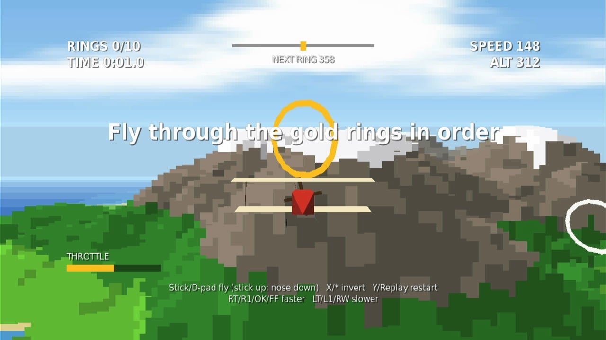

# Voxel Terrain

`BGE.DrawableVoxelTerrain` draws hills from a heightmap, the way NovaLogic's Comanche (1992) did:
for each screen column, a ray steps over the map from near to far, and wherever the ground rises
into view it draws a vertical strip. There are no polygons, so it's cheap enough for real hills on a
Roku, at the cost of a blocky, low-resolution look (quality sets how many columns). Flat ground is
better done with a [`DrawablePlane`](/drawables-and-scene-objects).

It needs a `Camera3d`, and a renderer draws one terrain at most.



## Maps

A `BGE.VoxelMap` is a square grid, 64 to 1024 cells along each side (a power of 2), with a height
(0-255) and a colour for every cell. Colours are indexes into a palette of up to 256 RGB colours.
The map also keeps smaller copies of itself (mip levels) for drawing far terrain without flicker.

Past its edges a map either repeats (`edgeMode: "wrap"`, so it should tile) or is a flat floor of
one height and colour (`edgeMode: "flat"`, e.g. sea round an island).

### Baking a map from images

Paint a grayscale heightmap (black is 0, white 255) and a colour map the same size in any
paint program, then bake them into a `.bvox` file:

```sh
python3 tools/voxel-map.py heights.png colors.png island.bvox --edge flat --flat-height 60 --flat-color 2A5DA8
```

The colour map can have any number of colours: more than 256 are reduced to 256. The tool needs only
Python 3. Load the file in your game:

```brighterscript
map = BGE.VoxelMaps.fromFile("pkg:/maps/island.bvox")
```

Loading is quick (a 256 map takes ~2 ms on a Roku Ultra), so do it whenever you need it. The file's
byte layout, and the code for making and editing maps, are at the end of this guide.

### Other ways to make one

- `BGE.VoxelMaps.fromArrays(size, heights, colors, palette, options)` from integer arrays you've
  built in code.
- `BGE.VoxelMapGenerator` makes random tileable maps: diamond-square heights coloured by height
  bands (water, sand, grass, forest, rock, snow by default) and shaded by slope. It's slow (~1.3 s
  for 256x256 on a Roku Ultra, long enough to trip the watchdog on slower devices), so generate a
  map once and keep it: `map.saveToFile("tmp:/world.bvox")`.

## Adding the terrain

```brighterscript
terrain = new BGE.DrawableVoxelTerrain(entity, map, {
  cellSize: 4,        ' world units per map cell
  heightScale: 1.5,   ' world units per height unit
  fade: {color: &h8EC5F0, start: 0.5}
})
entity.addDrawable("terrain", terrain)
```

The entity's position (plus the drawable's `offset`) is map cell (0, 0). Map x and z are world x
and z, and a height of 255 is `255 * heightScale` above the entity.

To stand something on the terrain, `terrain.heightAt(worldX, worldZ)` gives the ground's world y
there, blended between cells.

`setMap(map)` swaps the map. Call it too after changing a map's heights or colours in place, or
the terrain keeps drawing what it had.

## What draws over what

The terrain draws after the ground planes and before [level walls](/drawables-and-scene-objects)
(walls always draw over it). Everything sorted by depth (sprites, models) is tested against the
hills: one wholly behind a hill isn't drawn, and one partly behind it is drawn and then the
nearer hillside is drawn back over it. This is exact to a screen column.

Nothing is drawn above the terrain, so put a skybox or a backdrop behind it.

## Fog and fading

With `Camera3d.fog` on, far terrain fades into the fog colour across the camera's
`drawDistanceFadeFraction` band, like objects and walls. With it off, set `fade` to fade it
into another colour (usually the sky's) from `start` (a fraction of the draw distance) to the far
end. Without either, the terrain just stops at the draw distance.

## Roll and pitch

Roll works at any angle: the terrain is drawn level into a square bitmap as wide as the screen's
diagonal, then turned onto the screen. That bitmap is kept while rolled: ~8.6 MB at 1280x720, ~19 MB
at 1920x1080, which counts against the device's texture memory.

Pitch is harder: the terrain's columns stay upright, so it can't truly look up or down. `pitchMode`
picks how it copes:

- `horizonShift` (default): the horizon moves up or down. This is cheap, but only right near
  level. Past about 15 degrees up or down, objects float above or sink into the ground.
- `exact`: every step is projected with the pitched camera, so objects sit on the ground at any
  pitch. It costs about a third more. Objects near the screen edges drift sideways a little at
  steep pitches, since the columns can't lean.

Or make the camera match the terrain instead: with `camera.pitchMode = "shear"` the whole view
pitches the way `horizonShift` does (it stays level and the image moves up or down), so objects,
walls and planes sit exactly on the hills at any pitch, at `horizonShift`'s cost. Vertical lines
stay vertical, which suits the retro look; it reads as looking up or down up to about 30 degrees.
The terrain ignores its own `pitchMode` under a shear camera.

## Quality and cost

The cost is almost exactly columns x depth steps, about 4 µs each on a Roku Ultra. Quality sets
both (`voxelColumns`, `voxelBandSteps`, see [Render Quality](/render-quality)); the draw distance
sets how many steps there are. While the camera is still, the terrain draws the same strips again
without marching.

Flying and turning over a 256 map, terrain only, on a Roku Ultra at 1280x720:

| Level  | Columns | `horizonShift` | `exact` | `horizonShift`, rolled |
| ------ | ------- | -------------- | ------- | ---------------------- |
| Basic  | 50      | 48 fps         | 38 fps  | 39 fps                 |
| Low    | 64      | 39 fps         | 31 fps  |                        |
| Medium | 80      | 30 fps         | 23 fps  | 24 fps                 |
| High   | 100     | 24 fps         | 18 fps  |                        |
| Ultra  | 100     | 21 fps         | 16 fps  | 17 fps                 |

On a Roku Express (HD, so the engine caps the draw distance at 1000 units: ~74 depth steps a column
where the Ultra takes ~99) the same flight runs at about half the Ultra's frame rate. Each column
step costs ~8.5 µs, about twice the Ultra's:

| Level  | `horizonShift` | `exact` | `horizonShift`, rolled |
| ------ | -------------- | ------- | ---------------------- |
| Basic  | 23 fps         | 17 fps  | 23 fps                 |
| Low    | 18 fps         | 15 fps  |                        |
| Medium | 15 fps         | 11 fps  | 15 fps                 |
| High   | 13 fps         | 9 fps   |                        |
| Ultra  | 11 fps         | 8 fps   | 11 fps                 |

On an Express, start at Basic or Low and keep the objects in view few.

Objects cost the same as anywhere else, plus the hill test for each one in view: ~0.2 ms for a
`directScaled` sprite on a Roku Ultra, ~0.3 ms for other kinds. The test is relatively dearer on an
Express: ~0.9 ms per sprite (35 ms for 40 at Medium).
The rendererTest app's **Voxel Terrain** demo (`demo=voxel-terrain`) shows all of this, and with
`sweep=1` it prints these numbers for your own device.

## The .bvox format

A `.bvox` file is a `BGE.VoxelMap` as bytes. `tools/voxel-map.py` and `map.saveToFile()` write
one, and `BGE.VoxelMaps.fromFile()` reads one. Every field is a single byte, so there's no byte
order to get wrong. This is version 1; the reader rejects any other version. Bump the version for
any change to the layout.

| Offset | Bytes | Field | Value |
| ------ | ----- | ----- | ----- |
| 0 | 4 | magic | `BGEV` (66 71 69 86) |
| 4 | 1 | version | `1` |
| 5 | 1 | size shift | log2 of the side length, 6 to 10 (64 to 1024) |
| 6 | 1 | level count | 1 to 6, fewer for small maps (a 64 map has at most 4) |
| 7 | 1 | edge mode | `0` wrap, `1` flat |
| 8 | 1 | flat height | 0-255, used with flat edges |
| 9 | 1 | flat colour | a palette index, used with flat edges |
| 10 | 1 | palette count | 1-255, or `0` for 256 |
| 11 | 3 per colour | palette | red, green, blue for each colour, in order |
| 11 + 3 x palette count | 2 per cell, per level | levels | level 0 first |

Each level is `2^(size shift - level)` cells square. Within a level, the file holds all its heights
(one byte each, 0-255), then all its palette indexes, both row by row. Cell (x, z) is at index
`z * side + x`.

So the file is `11 + 3 x palette count + 2 x (sum of side x side over the levels)` bytes. A 64 map
with 4 levels and 3 colours is 11 + 9 + 2 x (4096 + 1024 + 256 + 64) = 10,900 bytes.

The reader checks the magic, version, size shift, level count, edge mode and the exact length.
It doesn't check the heights or palette indexes in the levels. A palette index past the palette
draws as palette colour 0, so a bad file can't crash a draw.

## VoxelMap data API

Make a map with a function on `BGE.VoxelMaps`. Each one returns a `BGE.VoxelMap`, or `invalid`
with the reason printed to the log, so check for `invalid` before you use the result.

- `fromFile(path)` loads a `.bvox` file.
- `fromByteArray(bytes)` reads a `.bvox` from an `roByteArray` you have in memory.
- `fromArrays(size, heights, colors, palette, options)` takes flat arrays, row by row (index
  `z * size + x`), and builds the mip levels for you. It checks every value: size a power of 2 from
  64 to 1024, 1-256 palette colours, heights 0-255, and colour indexes inside the palette.
- `fromLevels(sizeShift, palette, heightLevels, colorLevels, options)` takes mip levels you have
  already built, such as a generator's. It checks the level sizes and the edge settings, but not the
  cell values, so the levels must be right.

`options` is a `BGE.VoxelMapOptions`. Its fields are all optional: `edgeMode` (`"wrap"` by
default, or `"flat"`), `flatHeight` and `flatColor`.

Here's a 64 map from a formula, flat past its edges:

```brighterscript
size = 64
heights = [] as integer[]
colors = [] as integer[]
for z = 0 to size - 1
  for x = 0 to size - 1
    heights.push((x + z) mod 256)
    colors.push((x + z) mod 3)
  end for
end for
palette = [&hFF0000, &h00FF00, &h0000FF]
map = BGE.VoxelMaps.fromArrays(size, heights, colors, palette, {
  edgeMode: BGE.VoxelEdgeMode.flat,
  flatHeight: 40,
  flatColor: 2
})
if map = invalid
  print "the map isn't valid, see the log"
end if
```

With mip levels you've built yourself, use `fromLevels`. Level 0 comes first, and each level is a
quarter the size of the one before:

```brighterscript
function makeFromLevels(heightLevels as roByteArray[], colorLevels as roByteArray[]) as dynamic
  palette = [&h2A5DA8, &h808080] as integer[]
  return BGE.VoxelMaps.fromLevels(6, palette, heightLevels, colorLevels, {edgeMode: "wrap"})
end function
```

### Mip rules

A map has up to 6 levels, level 0 being the full size. Each level halves the side, and no level is
smaller than 8 x 8. Each cell of a level is made from the 2 x 2 cells above it:

- Heights: the average of the four, rounded down: `(a + b + c + d) \ 4`.
- Colours: the most common palette index of the four. On a tie, the first in this order wins:
  (x, z), (x + 1, z), (x, z + 1), (x + 1, z + 1). If all four are different, that's (x, z).

`tools/voxel-map.py` uses the same rules, so `fromArrays` and the tool give the same levels. If you
bake levels in your own tool, follow these rules too.

### Other members

A `BGE.VoxelMap` has these for a tool author to use:

| Member | What it does |
| ------ | ------------ |
| `getLevelCount()` | the number of levels, level 0 included |
| `cellHeight(ix, iz)` | the height (0-255) of a cell, past the edges by `edgeMode` |
| `colorAt(ix, iz)` | the palette index of a cell, past the edges by `edgeMode` |
| `heightAt(x, z)` | the height at a map position in cells, blended from the four nearest cells (cell i's centre is at i + 0.5) |
| `toByteArray()` | the map as `.bvox` bytes |
| `saveToFile(path)` | writes the `.bvox` file, and returns whether it worked |

The fields `size`, `sizeShift`, `palette`, `heightLevels`, `colorLevels`, `edgeMode`, `flatHeight`
and `flatColor` are public too. `heightLevels` and `colorLevels` are per level, level 0 first.

Editing `heightLevels[0]` in place doesn't update the other levels, so the mips go stale. The
simplest fix is to read the map out, change it, and rebuild it with `fromArrays`:

```brighterscript
' Raises a square of cells to the top of the scale. Rebuilds the map, so the mips stay right.
function raiseSquare(map as BGE.VoxelMap, x0 as integer, z0 as integer, side as integer) as dynamic
  size = map.size
  heights = [] as integer[]
  colors = [] as integer[]
  for z = 0 to size - 1
    for x = 0 to size - 1
      heights.push(map.cellHeight(x, z))
      colors.push(map.colorAt(x, z))
    end for
  end for
  for z = z0 to z0 + side - 1
    for x = x0 to x0 + side - 1
      heights[(z and map.mask) * size + (x and map.mask)] = 255
    end for
  end for
  return BGE.VoxelMaps.fromArrays(size, heights, colors, map.palette, {
    edgeMode: map.edgeMode,
    flatHeight: map.flatHeight,
    flatColor: map.flatColor
  })
end function
```

That's fine for a one-off edit. It's a full pass over the map, so bake the result to a `.bvox`
rather than editing at load time.
